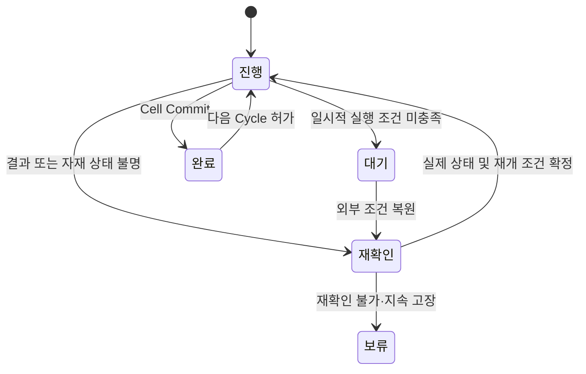

# Conveyor Pick & Place Cell — Cell Process Design (초안)

- **대상 공정:** `conveyor-pnp-poc` / 단일 자재 반복 공급–이송–Pick–Place
- **Owner:** Cell 공정 설계 책임자 (선정 필요)
- **상태:** 설계 초안

> 공정 순서·Gate·완료 확정·중단 후 재개 계약을 정의한다. PLC/BT의 내부 상태와 실행 구현은 Cell Control 및 각 System FDS의 책임으로 남긴다.

## 공정 목적과 순서

- **목적:** 한 자재를 공급 지점에서 Pick 위치까지 이송하고 로봇으로 배출 지점에 옮긴 뒤 다음 Cycle에 자동 진입한다.
- **입력:** 공급 가능한 자재 1개, 컨베이어·스토퍼·로봇·배출 지점의 관측 상태.
- **출력:** 배출 지점에 적재가 확인된 자재 1개와 해당 작업의 확정 결과.

## 단계별 Gate와 완료 확정

| 단계 | Start Gate·판단 주체 | 자재·형상 변화 | Completion Gate·확인 주체 | 완료 확정 기준·주체 |
|---|---|---|---|---|
| P1 공급 허용 | 투입·이송 영역과 배출 트레이 슬롯이 비어 있음 · PLC | 새 자재 공급 위치에 출현 | `infeed_part_detected` 확인 및 공급 명령과 대응 · PLC | 해당 Cycle의 자재 공급 수락 · PLC |
| P2 이송·위치 확정 | 공급된 자재, 이송 전 유효한 `pick_station_part_detected=FALSE`, 컨베이어 가동 가능, Pick 구역에 로봇 없음 · PLC | 자재가 Pick 지점으로 이동 | 이번 이송 중 신규 감지 후 현재 점유, 유효한 `conveyor_stopped_feedback=TRUE`와 `stopper_extended_feedback=TRUE` 확인 · PLC | 세 조건으로 `pick_position_confirmed` 판정 · PLC |
| P3 로봇 Pick·Place | `pick_position_confirmed` 유지, Robot Ready · PLC | 자재를 고정 트레이 슬롯에 배치 | 같은 요청 ID의 terminal 결과와 `material_placed` 확인 · 로봇 → PLC | 정상 성공은 P4 진입. 배치 후 실패는 아래 복구 경로 적용 |
| P4 인수 확인·Commit | 같은 요청의 정상 성공 또는 배치 후 실패에 대한 복구 조건 충족 · PLC | 트레이 슬롯에서 자재 인수 | 해당 요청의 `material_placed=true` 및 유효한 `tray_slot_occupied_feedback=TRUE` 확인 · PLC | 같은 Cycle의 인수를 단 한 번 Cell Commit · PLC |
| P5 다음 Cycle | 현재 Cycle Commit 확인 · PLC | 배출 설비가 인수된 자재를 자동 배출 | 실제 슬롯이 비고 투입·Pick 공간 재사용 가능, Robot Ready · PLC | 다음 P1 허가 · PLC |

P1에서 비어 있던 고정 슬롯은 이 Cycle의 자재만 받을 수 있고, P4가 끝날 때까지 자재를 유지한다. 정상 경로에서 PLC는 결과와 점유가 어느 순서로 도착해도 둘 다 확인한 뒤 인수를 확정한다. 응답이 늦거나 연결이 복원되면 요청 ID·결과·Commit 기록과 실제 슬롯 점유를 대조한다. 점유만으로 이전 작업을 완료하거나 초기화로 슬롯을 비었다고 판정하지 않는다.

## 중단·대기·복구와 재개

| 상황 | 보존할 정보·영향 범위 | 복구 주체·재확인 | 재개 조건·지점 |
|---|---|---|---|
| 컨베이어 순간 정지/드라이브 Busy | 활성 Cycle과 해당 이송의 감지 이력 보존, 새 공급 보류 | PLC가 구동기와 자재 위치 재확인 | 이미 Pick 위치이면 정지·고정 상태를 확인하고, 자재가 이송 경로에 있고 위치가 확인되면 P2 이송 재개 |
| `pick_station_part_detected` 지연·일시 소실, 정지 피드백 지연·무효 | P2 미완료, P3 요청 금지 | PLC가 해당 이송의 해제→신규 감지와 현재 점유, 실제 정지 및 고정 위치를 대조 | 유효한 증거가 모두 복원되면 P2 완료, 누락된 전이를 복원할 수 없으면 보류 |
| 센서 위치 오설정·지속 고장 | 자재 위치 미확정, 중복 공급 금지 | PLC가 불일치를 보고하고 필요 시 재관측 또는 작업자 확인 | 증거 없이는 자동 재개 금지. PoC의 자동 복구 대상에서 제외 |
| 로봇 Busy/응답 지연 | 요청 ID 보존, 새 작업 중복 제출 금지 | PLC–Adapter가 마지막 수락/실행 결과 대조 | 동일 작업 진행 또는 terminal 결과 관측 후 P3/P4 |
| 복구 가능한 일반 Motion 실패 | 활성 작업과 자재 상태 보존 | Task Execution BT가 기존 작업 내부 복구를 수행. 상위 재시도 여부는 Orchestration 계약을 따름 | 허용된 복구가 성공하면 자동으로 계속한다. PLC가 PnP를 다시 제출하지 않는다 |
| Place 결과 전송 누락 | 슬롯의 자재를 유지하고 미확정 상태 보존 | PLC–Adapter가 같은 ID의 terminal 결과와 배치 사실 조회 | P4 근거가 일치하면 정확히 한 번 확정, 불명확하면 보류 |
| 배치 후 Retreat·GO_HOME 실패 | 원래 실패 결과와 `material_placed=true` 보존. 재Pick·재Place 금지 | 로봇 Owner가 기존 계약으로 복구 가능 여부 판단 | 허용된 복구가 끝나고 Robot Ready이면 같은 슬롯의 인수를 P4에서 확인. 복구 불가·미확정 시 보류 |
| 배출 슬롯 점유 지속 | 미확정 자재 또는 이미 Commit된 자재 여부 보존 | PLC가 Commit 기록과 슬롯 점유 대조 | 미확정이면 배출 보류. 이미 Commit된 자재는 P5에서 배출하고 빈 슬롯 확인 후 다음 P1 허가 |
| PLC–Adapter 통신 단절 | 요청 ID·실행 결과·Commit 기록 보존 | Adapter가 기존 요청을 조회하고 PLC가 실제 자재 위치·슬롯 점유와 대조 | 상태가 일치하는 미완료 단계에서 계속한다. 불명확하면 재실행·Commit 없이 보류 |
| Safety 선점 | 중단 결과와 이미 확정된 배치 사실 보존. 중단 작업 재실행 금지 | [Safety](../../components/safety/fds-stop-recovery.md) 및 [Controlled Recovery](../../components/orchestration/fds-controlled-recovery.md)의 허가·복구 경로 적용 | 필요한 관리자 Reset과 정식 복구 조건 충족 후 공정 재평가. 이미 배치했다면 재Pick·재Place 없이 P4 확인 |

BT의 기존 재시도 범위와 종료 결과를 따른다. 지속 고장이나 상태 불명은 해당 작업을 보류하고, 관리자 Reset이 필요한 Safety 선점은 무인 복구 실적에서 제외한다.

## 고장 주입 및 주요 검증 계약

| 검증 ID | 대상 계약 | 주입 시나리오 | 기대 결과 |
|---|---|---|---|
| `VC-01` | 정상 자동 반복 | 빈 트레이 슬롯에서 기준 Cycle만큼 반복 | Cycle마다 인수 Commit 1회, 자동 배출 후 빈 슬롯에서 다음 자재 공급. 수동 조작 0회 |
| `VC-02` | 이송 중 복구 | 벨트 운전 중 일시 정지 후 상태 정상화 | 자재 중복 생성 없이 P2에서 자동 재개 |
| `VC-03` | 위치·정지 확인 | (a) 이송 중 `pick_station_part_detected` 지연 후 복원, (b) Stop 명령 후 벨트 감속 중 또는 정지 피드백 무효 | 각각 P3 요청 0회. 해당 이송의 신규 감지·현재 점유와 유효한 정지·스토퍼 고정 확인 후 진행 |
| `VC-04` | 센서 영구 불일치 | 이송 전부터 `pick_station_part_detected`이 TRUE로 고착되거나, 센서 위치가 어긋나 이송 중 도착 감지가 없음 | 이번 이송의 해제→신규 감지를 확인할 수 없어 P2 보류, Pick·추가 공급 0회 |
| `VC-05` | Robot Busy 지연 | 작업 수락 후 terminal 결과 지연 | 같은 ID로 Action 중복 실행하지 않음 |
| `VC-06` | 일반 Motion 실패 | BT 내부에서 복구 가능한 Pick 동작 실패 주입 | 기존 BT 복구 뒤 자동 진행, PLC의 중복 PnP 제출 0회 |
| `VC-07` | 인수 증거와 결과 유실 | 슬롯 점유 후 유실된 terminal 재조회 또는 정상 terminal 뒤 점유 피드백 도착. 결과 재전달 | 한쪽 근거만 있으면 Commit·배출 0회. 두 근거 확인 후 Commit 정확히 1회, 재Pick 0회 |
| `VC-08` | 통신 단절 | P3 실행 중 또는 P4 Commit 직후 연결 단절·복원 | 기존 요청 결과·실제 슬롯·Commit 기록 대조. 실행 중 작업 재제출 및 중복 Commit 0회, 근거 미확정 시 보류 |
| `VC-09` | 슬롯 수용·재사용 | 기동 시 출처 불명 자재가 있거나 Commit 후 실제 배출이 지연됨 | 점유 중 새 공급 0회. 출처 불명이면 보류. Commit된 자재의 배출이 끝나 빈 슬롯이 확인되면 자동 진행 |
| `VC-10` | 배치 후 중단 | 슬롯 점유 후 (a) Retreat·GO_HOME 실패 또는 (b) 관리자 Reset이 필요한 Safety 선점 | 두 경우 모두 원래 결과와 `material_placed=true` 보존, 재Pick·재Place 0회. (a)는 허용된 복구 후 P4, (b)는 Reset·Safety 허가·Controlled Recovery 조건 충족 전 재개 0회. 인수 확정은 Cycle당 1회 |

- **Fault Injection 원칙:** 정식 센서/장치 관측 경로에 고장을 주입한다. 시험기가 PLC·BT의 확정 상태를 직접 덮어쓰거나 Simulator Ground Truth를 우회 공급하지 않는다.
- **시험 반복성:** 시나리오 ID, 주입 시점/지속 시간/해제 조건, 초기 자재 상태와 기대 결과를 기록한다. 세부 실행 설정·결과는 별도 시험 자산에서 관리한다.
- **가상 시운전 주장 범위:** 공정 제어 계약·복구를 확인하는 것이며 실제 장비의 모터 성능·정밀 티칭·기계 내부 복구·Safety 인증을 주장하지 않는다.
