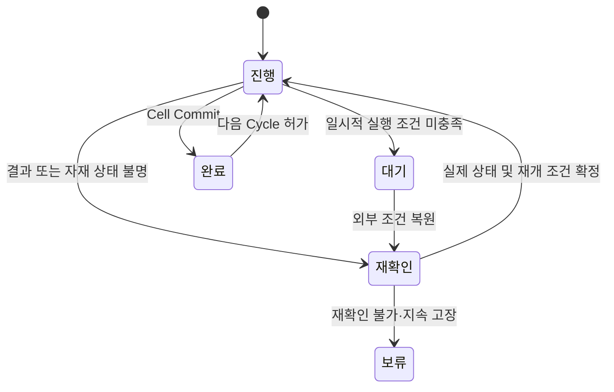

# Conveyor Pick & Place Cell — Cell Process Design (초안)

- **대상 공정:** `conveyor-pnp-poc` / 단일 자재 반복 공급–이송–Pick–Place
- **Owner:** Cell 공정 설계 책임자 (선정 필요)
- **상태:** 설계 초안

> 공정 순서·Gate·완료 확정·중단 후 재개 계약을 정의한다. PLC/BT의 내부 상태와 실행 구현은 Cell Control 및 각 System FDS의 책임으로 남긴다.

## 공정 목적과 순서

- **목적:** 한 자재를 공급 지점에서 Pick 위치까지 이송하고 로봇으로 배출 지점에 옮긴 뒤 다음 Cycle에 자동 진입한다.
- **입력:** 공급 가능한 자재 1개, 컨베이어·스토퍼·로봇·배출 지점의 관측 상태.
- **출력:** 배출 지점에 적재가 확인된 자재 1개와 해당 작업의 확정 결과.

## 단계별 Gate와 완료 확정

| 단계 | Start Gate·판단 주체 | 자재·형상 변화 | Completion Gate·확인 주체 | 완료 확정 기준·주체 |
|---|---|---|---|---|
| P1 공급 허용 | 이전 작업의 후속 자재 투입 허가, 투입/이송 영역이 비어 있음 · PLC | 새 자재 공급 위치에 출현 | `S_IN` 확인 및 공급 명령과 대응 · PLC | 해당 Cycle의 자재 공급 수락 · PLC |
| P2 이송·위치 확정 | 공급된 자재, 컨베이어 가동 가능, Pick 구역의 로봇 진입 없음 · PLC | 자재가 `S_IN`에서 `S_PICK`로 이동, 형상 불변 | `S_PICK` 관측, 벨트 정지 확인, 스토퍼 위치 확인 · PLC | Pick 지점 준비 상태 확정 · PLC |
| P3 로봇 Pick·Place | 자재 위치 확정, 로봇 Ready, Pick 구역의 설비 허가 · PLC/Robot 각자 | 자재 `POSITIONED` → `HELD` → `PLACED`, 형상 불변 | 해당 ID의 로봇 작업 terminal 성공 · BT/Task Execution | 로봇 작업 성공만 확정, Cell 전체 완료는 아직 아님 · 로봇 실행 Owner |
| P4 적재 확인·Commit | P3 성공 보고, 트레이 수용 가능 · PLC | 자재 `PLACED` → `ACCEPTED` | 해당 Cycle에 대해 `S_OUT` 신규 통과 이벤트(이전 Cycle 이후 센서 해제 확인)과 P3 성공 근거의 정합성 · PLC | **Cell 완료는 PLC가 단 한 번 확정**; 로봇 측 결과만으로는 미확정 |
| P5 다음 Cycle | 이전 Cycle 완료 확정 또는 해당 계약에 따른 정리, Robot Ready · PLC | 이전 자재는 배출 지점에 유지 | 투입·Pick 공간 재사용 가능 · PLC | 새 Cycle 허가 · PLC |

`S_OUT`는 단일 자재·하나의 활성 Cycle이라는 PoC 조건에서 **해당 Cycle의 신규 FALSE→TRUE 감지 이벤트**로 적재 관측을 보조하며, 다음 Cycle 전 FALSE 복귀를 확인한다. 이전 Cycle에서 유지된 TRUE 값을 이번 Cycle의 완료 근거로 재사용하지 않는다. 실제 현장에서 자재 ID 단위 확인이 필요하면 비전·바코드 등 별도의 식별 증거가 필요하다. `S_OUT`만으로 자재 ID가 검증된 것으로 간주하지 않는다.

## 중단·대기·복구와 재개

| 상황 | 보존할 정보·영향 범위 | 복구 주체·재확인 | 재개 조건·지점 |
|---|---|---|---|
| 컨베이어 순간 정지/드라이브 Busy | 활성 Cycle, 미완료 자재; 새 공급 보류 | PLC가 구동기 정상화와 센서 상태 확인 | 이송 명령을 재개하고 `S_PICK` 위치 확인으로 P2 계속 |
| `S_PICK` 응답 지연·일시 소실 | 자재 위치 미확정, P3 시작 금지 | PLC가 복원된 실제 센서 신호와 예정된 이동 맥락을 확인 | 위치 확정 시 P2 완료, 불확실하면 P2 보류 |
| 센서 위치 오설정·지속 고장 | 자재 위치 미확정, 중복 공급 금지 | PLC는 상태 불일치 보고; 필요 시 별도 재관측/작업자 확인 | 증거 없이는 자동 재개 금지. PoC의 자동 복구 대상에서 제외 |
| 로봇 Busy/응답 지연 | 요청 ID 보존, 새 작업 중복 제출 금지 | PLC–Adapter가 마지막 수락/실행 결과 대조 | 동일 작업 진행 또는 terminal 결과 관측 후 P3/P4 |
| 복구 가능한 Pick 실패 | 자재·Robot Holding 및 요청 결과 보존 | 로봇 BT가 승인된 재계획·재시도 | 성공 시 P3 완료; 필요시 새로운 상태 관측. PLC는 내부 Retry를 중복 지시하지 않음 |
| Place 결과 전송 누락 | P3 종료/Cell Commit 미확정 | PLC–Adapter가 동일 요청 ID의 결과를 조회·재동기화 | 결과와 적재 근거 일치 시 P4 확정, 아니면 보류 |
| PLC–Adapter 통신 단절 | 마지막 요청 ID·확정 결과·기기 상태 보존 | Adapter 재접속 후 진행 중/최종 결과 조회 | 중복 Action 없이 미완료 단계로 재진입 |
| 안전 관련 정지 | 영향받는 공정 상태 기록 | 안전 제어권자가 해제 승인, Cell은 이후 업무 상태 재확인 | 안전 허가와 공정 재개 조건이 모두 충족될 때만 진행 |

복구 가능한 일시 고장에는 불필요한 전체 시스템 재기동이나 단순 횟수 제한에 따른 자동 포기를 요구하지 않는다. 지속적인 고장·확인 불가능한 상태에서는 계속 동작하는 것이 아니라 해당 작업을 보류하는 것이 올바른 결과다.

## 고장 주입 및 주요 검증 계약

| 검증 ID | 대상 계약 | 주입 시나리오 | 기대 결과 |
|---|---|---|---|
| `VC-01` | 정상 자동 반복 | 적어도 제안된 기준 Cycle 연속 실행 | 각 Cycle 당 Cell Commit 1회, 수동 재시작 0회 |
| `VC-02` | 이송 중 복구 | 벨트 운전 중 일시 정지 후 상태 정상화 | 자재 중복 생성 없이 P2에서 자동 재개 |
| `VC-03` | 센서 미응답 | `S_PICK` 일시 지연/무응답 후 복원 | 위치 확인 전 Pick 금지, 복원 후 정상 확인 시 진행 |
| `VC-04` | 센서 영구 불일치 | `S_PICK` 물리 위치 어긋남 또는 stuck 상태 지속 | 근거 없는 자동 재개·Pick 금지, 영향 범위만 보류 |
| `VC-05` | Robot Busy 지연 | 작업 수락 후 terminal 결과 지연 | 같은 ID로 Action 중복 실행하지 않음 |
| `VC-06` | 일시 Pick 실패 | 로봇 작업 실행 시 복구 가능한 실패 주입 | BT 내부 복구 후 동일 Cell 작업을 정상 확정 |
| `VC-07` | 결과 유실 | Place 완료 직후 PLC 쪽 응답 소실 | 결과 재확인, 재 Pick 없이 Commit 최대 1회 |
| `VC-08` | 통신 단절 | PLC–Adapter 연결 단절·복원 | 마지막 명령과 로봇 상태 재동기화 후 해당 단계 재개 |
| `VC-09` | 후속 설비 Busy | 배출 지점 수용 불가능 상태 주입 | 새 Place/공급 보류, 해제 후 자동 진행 |

- **Fault Injection 원칙:** 정식 센서/장치 관측 경로에 고장을 주입한다. 시험기가 PLC·BT의 확정 상태를 직접 덮어쓰거나 Simulator Ground Truth를 우회 공급하지 않는다.
- **시험 반복성:** 시나리오 ID, 주입 시점/지속 시간/해제 조건, 초기 자재 상태와 기대 결과를 기록한다. 세부 실행 설정·결과는 별도 시험 자산에서 관리한다.
- **가상 시운전 주장 범위:** 공정 제어 계약·복구를 확인하는 것이며 실제 장비의 모터 성능·정밀 티칭·기계 내부 복구·Safety 인증을 주장하지 않는다.
