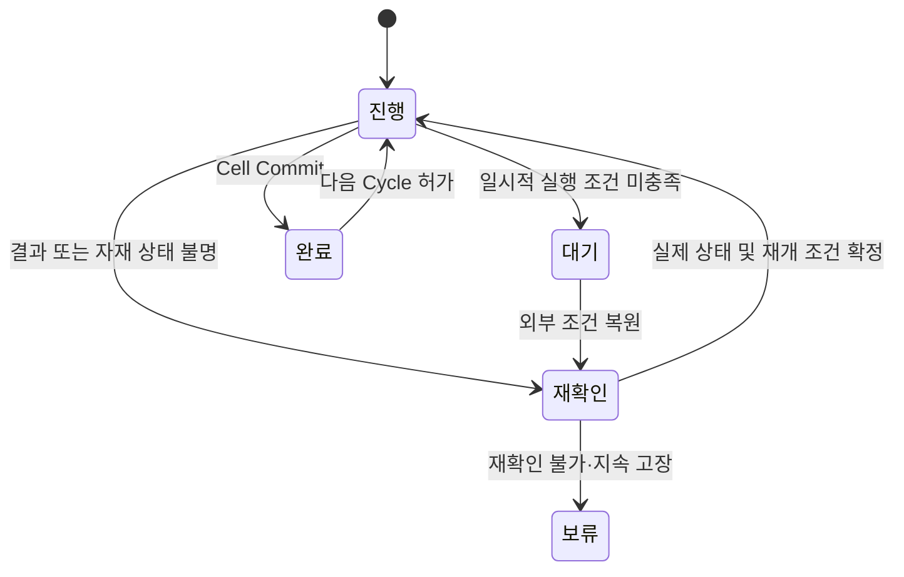

# Conveyor Pick & Place Cell — Cell Process Design (초안)

- **대상 공정:** `conveyor-pnp-poc` / 단일 자재 반복 공급–이송–Pick–Place
- **Owner:** Cell 공정 설계 책임자 (선정 필요)
- **상태:** 설계 초안

> 공정 순서·Gate·완료 확정·중단 후 재개 계약을 정의한다. PLC/BT의 내부 상태와 실행 구현은 Cell Control 및 각 System FDS의 책임으로 남긴다.

## 공정 목적과 순서

- **목적:** 한 자재를 공급 지점에서 Pick 위치까지 이송하고 로봇으로 배출 지점에 옮긴 뒤 다음 Cycle에 자동 진입한다.
- **입력:** 공급 가능한 자재 1개, 컨베이어·스토퍼·로봇·배출 지점의 관측 상태.
- **출력:** 배출 지점에 적재가 확인된 자재 1개와 해당 작업의 확정 결과.

## 단계별 Gate와 완료 확정

| 단계 | Start Gate·판단 주체 | 자재·형상 변화 | Completion Gate·확인 주체 | 완료 확정 기준·주체 |
|---|---|---|---|---|
| P1 공급 허용 | 투입·이송 영역이 비고 배출 설비가 한 자리를 수용 가능하다고 보고함 · PLC | 새 자재 공급 위치에 출현 | `S_IN` 확인 및 공급 명령과 대응 · PLC | 해당 Cycle의 자재 공급 수락 · PLC |
| P2 이송·위치 확정 | 공급된 자재, 이송 전 유효한 `S_PICK=FALSE`, 컨베이어 가동 가능, Pick 구역에 로봇 없음 · PLC | 자재가 Pick 지점으로 이동 | 이번 이송 중 `S_PICK` 상승 후 현재 점유, 드라이브의 유효한 정지 피드백, 스토퍼 고정 위치 확인 · PLC | 세 조건이 함께 성립하면 Pick 위치 확정 · PLC |
| P3 로봇 Pick·Place | P2 위치 확정 유지, Robot Ready, 해당 Cycle의 배출 자리 확보, 비어 있는 `S_OUT`에서 감지 시작 · PLC | 자재가 Pick 위치에서 로봇을 거쳐 배출 지점으로 이동 | 같은 요청 ID의 terminal 결과와 배치 사실 확인 · 로봇 → PLC | 정상 성공은 P4 진입. 배치 후 실패는 아래 복구 경로 적용 |
| P4 적재 확인·Commit | 같은 요청의 정상 성공 또는 배치 후 실패에 대한 복구 조건 충족 · PLC | 배치한 자재를 인수 | 같은 Cycle의 `material_placed=true`와 보존된 `S_OUT` 신규 감지가 일치 · PLC | 해당 Cycle이 미확정이면 Cell Commit 1회 · PLC |
| P5 다음 Cycle | 이전 Cycle Commit 또는 해당 계약에 따른 정리, Robot Ready · PLC | 인수한 자재가 감지 구간을 비움 | `S_OUT` 해제, 투입·Pick 공간 재사용 및 배출 수용 가능 · PLC | 다음 P1 허가 · PLC |

PLC는 P3 요청을 보내기 전부터 활성 Cycle에 대해 `S_OUT`의 FALSE→TRUE 전이를 관측한다. 설비 I/O는 PLC가 해당 전이를 취득할 수 있도록 전달한다. 배치 시 발생한 펄스가 로봇 복귀 중 끝나더라도 해당 Cycle의 증거를 보존한다. 로봇 결과가 먼저 도착하면 같은 Cycle의 감지를 기다린다. 재접속 후에는 보존된 증거와 Commit 여부를 대조한다. 현재 센서 레벨로 누락된 전이를 추정하거나 이전 Cycle의 감지를 재사용하지 않는다. 이 상관은 한 번에 자재 하나를 다루는 PoC에 적용한다.

## 중단·대기·복구와 재개

| 상황 | 보존할 정보·영향 범위 | 복구 주체·재확인 | 재개 조건·지점 |
|---|---|---|---|
| 컨베이어 순간 정지/드라이브 Busy | 활성 Cycle과 해당 이송의 감지 이력 보존, 새 공급 보류 | PLC가 구동기와 자재 위치 재확인 | 이미 Pick 위치이면 정지·고정 상태를 확인하고, 자재가 이송 경로에 있고 위치가 확인되면 P2 이송 재개 |
| `S_PICK` 지연·일시 소실, 정지 피드백 지연·무효 | P2 미완료, P3 요청 금지 | PLC가 해당 이송의 해제→신규 감지와 현재 점유, 실제 정지 및 고정 위치를 대조 | 유효한 증거가 모두 복원되면 P2 완료, 누락된 전이를 복원할 수 없으면 보류 |
| 센서 위치 오설정·지속 고장 | 자재 위치 미확정, 중복 공급 금지 | PLC는 상태 불일치 보고; 필요 시 별도 재관측/작업자 확인 | 증거 없이는 자동 재개 금지. PoC의 자동 복구 대상에서 제외 |
| 로봇 Busy/응답 지연 | 요청 ID 보존, 새 작업 중복 제출 금지 | PLC–Adapter가 마지막 수락/실행 결과 대조 | 동일 작업 진행 또는 terminal 결과 관측 후 P3/P4 |
| 복구 가능한 Pick 실패 | 자재·Robot Holding 및 요청 결과 보존 | 로봇 BT가 승인된 재계획·재시도 | 성공 시 P3 완료; 필요시 새로운 상태 관측. PLC는 내부 Retry를 중복 지시하지 않음 |
| Place 결과 전송 누락 | 같은 Cycle의 출력 감지 및 미확정 상태 보존 | PLC–Adapter가 같은 ID의 terminal 결과와 배치 사실 조회 | P4 근거가 일치하면 정확히 한 번 확정, 불명확하면 보류 |
| 배치 후 Retreat·복귀 실패 또는 Safety 선점 | 실패 결과와 `material_placed=true`를 함께 보존. 재Pick·재Place·새 공급 금지 | 로봇 Owner가 해당 복구 종료와 Ready를 보고하고, Safety 정지 시 권한자가 재개를 허가 | PLC는 해당 결과와 같은 Cycle의 출력 감지를 대조해 P4로 진행. 복구·증거 미확정 시 보류. 원래 로봇 실패 결과 보존 |
| 배출 설비 Busy | PLC는 새 공급과 새 자리 확보 보류. 이미 확보한 한 자리는 해당 Cycle의 배치까지 유지 | 배출 설비가 예약과 실제 수용 상태를 보고 | 일반 Busy는 이후 작업부터 적용. 확보한 자리 자체가 유실되면 release 전 Place 보류, 상태 재확인 후 해당 작업만 재개 |
| PLC–Adapter 통신 단절 | 마지막 요청 ID·확정 결과·기기 상태 보존 | Adapter 재접속 후 진행 중/최종 결과 조회 | 중복 Action 없이 미완료 단계로 재진입 |
| 안전 관련 정지 | 영향받는 공정 상태 기록 | 안전 제어권자가 해제 승인, Cell은 이후 업무 상태 재확인 | 안전 허가와 공정 재개 조건이 모두 충족될 때만 진행 |

복구 가능한 일시 고장에는 불필요한 전체 시스템 재기동이나 단순 횟수 제한에 따른 자동 포기를 요구하지 않는다. 지속적인 고장·확인 불가능한 상태에서는 계속 동작하는 것이 아니라 해당 작업을 보류하는 것이 올바른 결과다.

## 고장 주입 및 주요 검증 계약

| 검증 ID | 대상 계약 | 주입 시나리오 | 기대 결과 |
|---|---|---|---|
| `VC-01` | 정상 자동 반복 | 적어도 제안된 기준 Cycle 연속 실행 | 각 Cycle 당 Cell Commit 1회, 수동 재시작 0회 |
| `VC-02` | 이송 중 복구 | 벨트 운전 중 일시 정지 후 상태 정상화 | 자재 중복 생성 없이 P2에서 자동 재개 |
| `VC-03` | 위치·정지 확인 | (a) 이송 중 `S_PICK` 지연 후 복원, (b) Stop 명령 후 벨트 감속 중 또는 정지 피드백 무효 | 각각 P3 요청 0회. 해당 이송의 신규 감지·현재 점유와 유효한 정지·스토퍼 고정 확인 후 진행 |
| `VC-04` | 센서 영구 불일치 | 이송 전부터 `S_PICK`이 TRUE로 고착되거나, 센서 위치가 어긋나 이송 중 도착 감지가 없음 | 이번 이송의 해제→신규 감지를 확인할 수 없어 P2 보류, Pick·추가 공급 0회 |
| `VC-05` | Robot Busy 지연 | 작업 수락 후 terminal 결과 지연 | 같은 ID로 Action 중복 실행하지 않음 |
| `VC-06` | 일시 Pick 실패 | 로봇 작업 실행 시 복구 가능한 실패 주입 | BT 내부 복구 후 동일 Cell 작업을 정상 확정 |
| `VC-07` | 결과 유실·도착 순서 | `S_OUT` 펄스 종료 후 유실된 정상 terminal 재조회, 또는 terminal 선도착 후 출력 감지. 같은 결과 재수신 | 한쪽 근거만 있으면 Commit 0회. 양쪽이 같은 Cycle로 확인되면 정확히 1회, 재Pick 0회 |
| `VC-08` | 통신 단절 | PLC–Adapter 연결 단절·복원 | 마지막 명령과 로봇 상태 재동기화 후 해당 단계 재개 |
| `VC-09` | 배출 Busy | 공급 전 Busy, 공급 후 예약 거절, 예약 후 다음 자리 Busy, release 전 예약 자리 유실을 각각 주입 | 앞의 두 경우 새 공급 또는 P3 요청 대기. 유효한 예약은 해당 자재만 배치. 자리 유실 시 release 0회, 수용 복원·상태 대조 후 중복 없이 재개 |
| `VC-10` | 배치 후 로봇 실패 | 배치·출력 감지 후 Retreat 실패 또는 Safety 선점, 이후 복구 완료와 결과 재전달 | 재Pick·재Place 0회, 실패 결과 보존. 복구와 필요한 허가 전 Commit 0회, P4 증거가 갖춰지면 정확히 1회 |

- **Fault Injection 원칙:** 정식 센서/장치 관측 경로에 고장을 주입한다. 시험기가 PLC·BT의 확정 상태를 직접 덮어쓰거나 Simulator Ground Truth를 우회 공급하지 않는다.
- **시험 반복성:** 시나리오 ID, 주입 시점/지속 시간/해제 조건, 초기 자재 상태와 기대 결과를 기록한다. 세부 실행 설정·결과는 별도 시험 자산에서 관리한다.
- **가상 시운전 주장 범위:** 공정 제어 계약·복구를 확인하는 것이며 실제 장비의 모터 성능·정밀 티칭·기계 내부 복구·Safety 인증을 주장하지 않는다.
