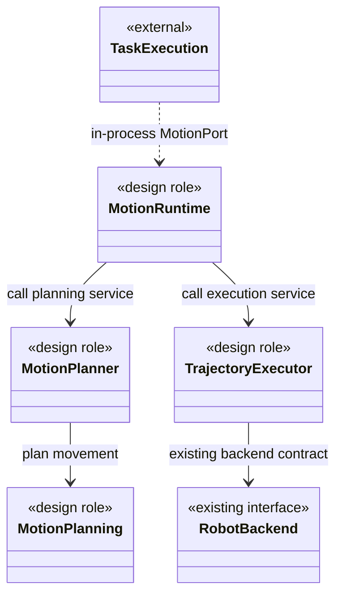
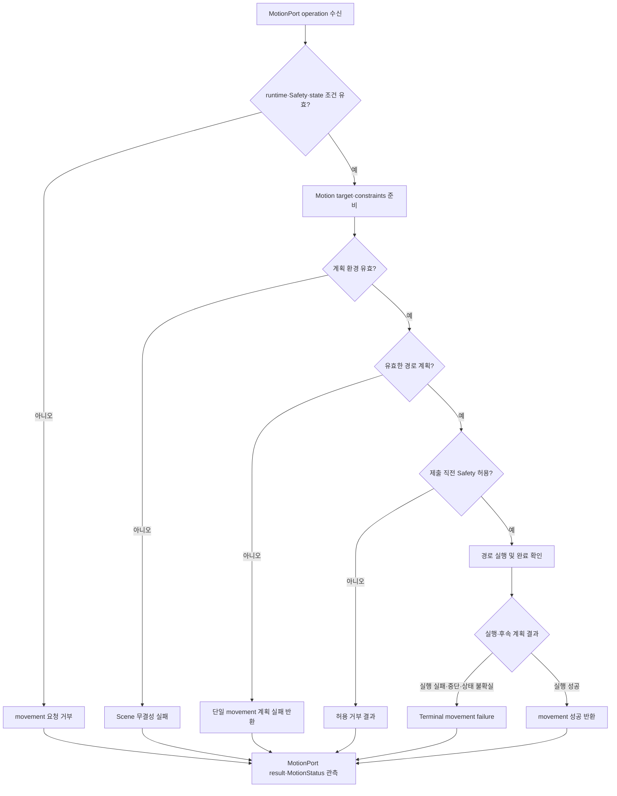
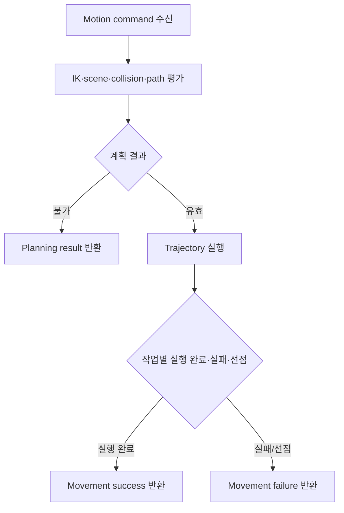
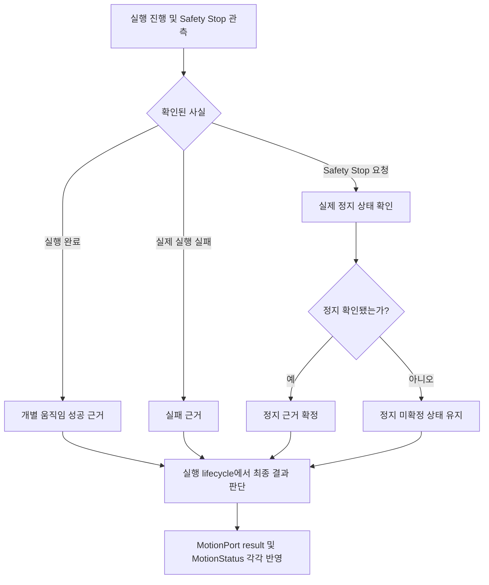

# [SF-Twin] ARM Cell Motion 컴포넌트 설계

- **Component ID:** `ARM Cell / Motion`
- **Owner:** `ARM Cell Motion`

## 목적과 책임

이 CDS는 Motion 내부의 planning·trajectory 역할과 Backend·상태 자원의 정적 소유 구조를 정의한다.

## 정적 구조와 경계

다이어그램은 **Motion 내부의 설계 책임**을 표현한다. `<<design role>>`은 실제 구현 클래스와 일대일 대응하지 않는 안정적인 책임 이름이다. 외부 경계는 Task Execution의 C++ MotionPort 및 existing Safety/backend contracts다. 화살표는 정적 의존 관계이며 실행 순서가 아니다.

`MotionRuntime`은 하나의 movement operation을 예약해 MotionPlanner와 TrajectoryExecutor에 위임한다. 외부 PnP Action은 이 구조에 포함하지 않으며 Task Execution의 in-process MotionPort contract만 연결한다.

Motion runtime은 Task Execution이 쓰는 단일 `GripperPort` 및 concrete Isaac adapter/transport를 소유·제공한다. Task Execution은 기존 Gripper command/holding choreography를 소유하며 같은 instance를 주입받는다. 물리 force/current/effort, 다중 관절 매핑 및 Isaac attachment는 adapter 책임이며 Motion이 직접 attach/detach하지 않는다. 공유 lifecycle은 [Task Execution–Motion ICD](../../interfaces/icd-task-execution-motion.md)와 [Motion Backend ICD](../../interfaces/icd-motion-backend.md)를 따른다.

Motion의 작업 환경은 고정 equipment/Tray/Rail과 이동 RawPart를 다루는 정적 material-handling domain이다. Dynamic obstacle tracking과 Scene 변화에 대한 일반 목적 continuous replanning은 범위 밖이며 가벼운 자재 간 접촉은 Safety·고정 설비 충돌 허용을 뜻하지 않는다. 정적 Geometry는 canonical environment에서 선택적으로 투영하고, generated artifact는 authority가 아니다. Loader는 선택 정적 객체만 변경하고 candidate occupancy·attached object 등 무관한 Planning Scene 상태를 보존하며 load/readback 오류를 드러낸다. `arm_cell_moveit_config`가 planning configuration을, robot model이 물리 joint/velocity limit를 소유한다. Motion은 joint continuity·충돌·configured velocity/acceleration 조건을 검증하며 planning-only 결과를 실행·Safety acceptance로 주장하지 않는다.

Vision-derived PICK에서 Motion은 Task Execution이 선택한 Candidate의 운동학적 실현과 단일 movement를 소유한다. Target별 관측 Occupancy 계산은 [Motion PICK Algorithm](../../algorithms/motion-pick-candidate-search.md), 공유 입력·결과 의미는 [Task Execution–Motion ICD](../../interfaces/icd-task-execution-motion.md)가 정의한다. 직접 지정 PICK의 기존 호환 점유 입력은 [Orchestration–Motion ICD](../../interfaces/icd-orchestration-motion.md)를 따른다. PICK/PLACE 전략 선택과 Candidate 순서는 Task Execution이 소유한다.

## 상위 책임 연동 흐름

위 그림은 Motion이 소유하는 단일 movement의 수락·계획·실행·결과 흐름이다. PICK candidate transition 및 PnP recovery는 [Task Execution PnP FDS](../task-execution/fds-pnp-execution.md)가 소유한다. 실제 trajectory 실행 실패와 계획 실패는 구별하며 Motion은 기존 result classification을 보존한다.

## 주요 역할별 책임 흐름

### 단일 movement의 Planning·실행 결과

Planning result는 개별 target/segment 결과다. candidate 우선순위·전환 횟수·PnP-level candidate-exhausted result는 Task Execution이 소유한다.

### Planning Scene 유효성

공유 Planning Scene은 고정 환경과 현재 attached object를 제공한다. Motion은 필요한 planning 검증에 그 Scene과 해당 target의 관측 Occupancy를 사용하며 공유 Scene 자체를 변경하지 않는다. Robot State는 canonical 최신 측정 상태를 사용한다. 동적 적용 범위와 수명은 [Motion Execution FDS](fds-motion-execution.md)가 소유한다.

### Planning 책임

Motion의 planning 책임은 Grasp Pose 후보 평가, 상태·충돌 검증 및 접근 경로 계획으로 나뉜다. PICK 후보 생성과 실패별 방문 순서는 [Motion PICK Algorithm](../../algorithms/motion-pick-candidate-search.md), 해당 단계의 동적 상호작용과 종료는 [Motion Execution FDS](fds-motion-execution.md)가 정의한다.

### 실행, Safety Stop 및 결과 확정

Safety가 Stop 권한과 원인·severity를 소유하며 Motion은 Stop을 집행하고 **실제 정지의 증거**를 보고한다. Safety Stop 요청 수락·명령 전송 또는 MotionPort 종료만으로 physical inactivity를 확정하지 않는다. Task Execution PnP Result는 전체 작업 종료 결과, MotionStatus는 현재 movement·정지 관측이며 서로를 추론하지 않는다. Stop/Completion 경합의 우선순위와 동적 전이는 [Stop and Recovery FDS](fds-stop-recovery.md), [Safety–Motion ICD](../../interfaces/icd-safety-motion.md)가 소유한다.

TrajectoryExecutor는 PICK/PLACE에서 계획 시간 및 명령 시퀀스 정상 수행을 근거로 완료를 확정한다.
Motion Progress는 수행 중 비정상 진행 정체, Trajectory Clock은 시간 진행 이상을 감시하며 완료 승인자가
아니다. 완료 이후 감시는 종료하고, 정확도·관절 변화량 관측은 진단 책임에 둔다. 세부 완료·오류·중단
경계는 [Motion Execution FDS](fds-motion-execution.md)가 소유한다. GO_HOME과 Stop의 기존 목표 도달·
정지 확인 책임은 분리해 유지한다.

## 소유권과 상태

| 상태·자원 | Authoritative owner / writer | Motion의 소비·관측 | lifecycle·일관성 경계 및 경합 위험 |
|---|---|---|---|
| Safety capability, permitted envelope, stop 원인·severity | Safety | 현재 capability/envelope 소비; Safety가 직접 StopMotion 시작 | 승인 재사용 금지; 제출 직전 재확인. Motion/Orchestration의 독립 Safety 재판정 금지 |
| measured robot state | Robot State integration | canonical state를 planning/execution 판단에 소비 | simulator articulation 등 backend state를 두 번째 canonical writer로 쓰지 않음; freshness/validity는 적용 계약에 따름 |
| active movement reservation·실행·MotionStatus | Motion | Task Execution, Safety, observers | 각 movement lifecycle은 Motion이 소유; PnP Action lifecycle은 Task Execution 소유 |
| Runtime Planning Scene | Motion planning-scene responsibility의 runtime collision authority | planning과 validation이 소비 | 고정 geometry와 attached-object state는 공유 Scene에 유지; 후보별 임시 Occupancy는 관련 planning 요청에서만 사용하며 공유 Scene을 변경하지 않음 |
| canonical nominal environment geometry | Simulation Environment Semantics 및 구성의 지정 owner | 선택된 고정 geometry를 planning projection에 소비 | 생성 artifact는 canonical authority가 아님; static projection은 선택적 profile 경계 |
| Gripper physical state / Holding observation | backend adapter가 관측 제공; PnP material disposition은 Task Execution | Task Execution은 GripperPort 결과를 소비; MotionStatus는 observation projection | command success와 physical disposition 분리; adapter topology/attachment를 task state authority로 승격하지 않음 |
| motion target·Recipe-derived constraints·Vision geometry | Task Execution이 motion request로 변환, 원본 의미는 Orchestration/Vision ICD | MotionPort가 전달된 pose/constraint만 소비 | 원본 Recipe/Observation 또는 mission/candidate policy를 재해석하지 않고 TCP realization과 planning을 수행 |

### 교란 작업의 Motion 책임

Motion은 Task Execution이 MotionPort로 제출한 교란 요청의 후보 우선순위, 접촉 위치·방향, 접근·밀기·후퇴 계획·실행을 소유한다. 정상 PICK·PLACE 계약과 작업 수량 회계는 변경하지 않는다. [Motion 교란 실행 FDS](fds-disturb-execution.md)가 단일 동적 의미 Owner다.

## 제공·요구 계약과 의존성

| Port·계약 | 의미 Owner | Consumer | Adapter / 실현 책임 | 의존성 상실 영향 |
|---|---|---|---|---|
| MotionPort / movement·disturb result | Task Execution–Motion ICD | Task Execution | 하나의 in-process C++ library interface; ROS transport 없음 | 단일 movement와 복합 disturb 결과를 PnP result/disposition과 구별 |
| Safety capability / permitted envelope / StopMotion | Safety–Motion ICD, Safety authority | Motion 및 Safety | Safety component와 backend 실행 adapter | 유효 permission 부재 시 새 trajectory 미실행; active stop은 Safety 직접 경로 및 Motion의 완료 관측 |
| canonical measured Robot State | [Simulation State·Time·TF ICD](../../interfaces/icd-sim-state-time-tf.md) 및 Robot State integration | Motion planning/execution | 선택 simulator 또는 hardware state adapter | 유효한 계획 시작 상태를 확립할 수 없으면 계획/실행 결과를 성공으로 확정할 수 없음 |
| GripperPort / HoldingObservation | Task Execution–Motion ICD 및 Motion Backend ICD | Task Execution; Motion runtime이 interface/adapter 제공 | 동일 simulator/hardware adapter instance | 기존 disconnect/stale observation result semantics를 따름 |
| canonical environment geometry 및 static-scene projection | Simulation Environment Semantics; Motion의 scene 책임 | Planning Scene 및 planner | 선택 static-scene profile과 bounded loader | 잘못된 load/readback은 감지 가능한 scene 오류; static scene 생략 프로파일을 cell-clearance acceptance로 표현하지 않음 |
| MotionStatus | Motion 의미, wire contract는 Safety–Motion ICD | Safety, Task Execution, Orchestration observer | Motion publication | 현재 움직임/정지 관측이며 PnP result/disposition을 대신하지 않음 |
| Vision candidates·Recipe policy | Vision/Orchestration ICD; MotionPort payload는 Task Execution 변환 | Task Execution에서 MotionPort로 전달 | 기존 public producer adapter, 단일 in-process consumer | invalid/incomplete motion input은 movement result로 전파; Vision/Mission policy를 Motion이 대체하지 않음 |

실행 가능한 interface 선언은 field·type·serialization의 source of truth다. 선택 planning profile과 robot physical limits는 각각 operational profile 및 robot model owner가 정하며, 이 CDS는 solver나 planner API를 지정하지 않는다.

## 불변조건, 오류 경계와 관측 가능성

| 검토 대상 | 판단·처리 책임 | 불변조건 또는 오류 전파 경계 | 관측 가능한 결과·진단 근거 |
|---|---|---|---|
| Safety capability와 envelope | Safety가 authority; Motion이 독립 집행 | Motion 자체 판단으로 Safety capability, 원인 또는 severity 대체 금지. admission 및 제출 직전 현재 permission을 사용하고 envelope 제한을 적용 | Motion 결과/상태와 Safety 상태가 각각 권위 있는 근거를 제공 |
| 계획과 실행 | Motion | 유효 계획은 실행 성공이 아님. PICK/PLACE Trajectory 완료·GO_HOME 목표 도달·Stop 완료는 각각 FDS의 독립 계약으로 확정 | terminal result, execution identity 및 측정/완료 provenance; 상세 판정은 FDS |
| Robot State / Planning Scene | Robot State owner / Planning Scene runtime authority | canonical state 소비; scene 상태의 중복 authority 금지. static geometry·attached object는 공유 Scene에서 소비하고 후보별 임시 Occupancy는 관련 요청에 한정 | 최신 measured start와 attachment를 유지; state/scene context 생성 실패가 결과 근거에서 구분 가능 |
| Gripper Holding | adapter가 관측; Task Execution이 PnP disposition 소유 | `HELD`, `RELEASED`, `UNKNOWN` 구별. 명령 성공이나 simulator attachment 구현은 Holding 사실을 대신하지 않음 | MotionStatus는 observation이고 Task Execution이 공정 결과를 확정 |
| backend·외부 의존성 상실 | 의존성을 요구한 Motion 책임이 실패 판정 및 전파 | backend, state, scene, Safety permission 또는 필요한 port를 확립할 수 없으면 영향받은 작업을 성공 처리하지 않음. stop dispatch acceptance는 실제 정지 아님 | 영향된 책임, 원인/결과, terminal outcome과 stop inactivity evidence 추적 |
| 결과 및 diagnostics | Motion은 실행 결과, 관측 진단은 각 producer | diagnostic 기록 실패/품질 observation이 execution result 의미를 덮어쓰지 않음. 로그 메시지/자료구조는 계약 아님 | task UUID/candidate provenance(해당 시), 결과 원인, Planning Detail/Summary와 적용 FDS의 진단 증거 |
| planning profile 경계 | profile/scene owner; Motion은 명시된 범위 보고 | robot-only planning은 static-cell collision 또는 production execution/safety acceptance가 아님. static scene은 명시적으로 선택 | 사용 profile과 claim scope가 review 및 acceptance evidence에서 구분 가능 |

오류 의미·전파 및 logging 공통 원칙은 Engineering robustness/errors/logging policy를 따른다. 상세 state transition, timeout, retry와 recovery는 FDS가 소유한다.

## 검증 요구사항

| ID | 소유 계약·불변조건 | Verification Requirement |
|---|---|---|
| `VR-MOT-OWN-01` | TCP correction ownership | Robot/tool-specific TCP correction은 Motion이 적용한다. |
| `VR-MOT-OWN-02` | Safety enforcement | Motion은 movement submission 경계에서 Safety capability를 집행한다. 제출 직전 재확인과 envelope 세부는 Safety–Motion ICD 및 FDS를 따른다. |
| `VR-MOT-OWN-03` | MotionStatus authority | externally meaningful Motion execution state의 canonical owner/publisher는 Motion이다. |
| `VR-MOT-OWN-04` | Backend insulation | Mission/Vision 계약은 simulator-specific gripper articulation topology에 의존하지 않는다. |
| `VR-MOT-GEO-01` | Object-reference conversion | observed reference에서 candidate TCP/tool rigid transform으로의 변환은 Motion만 소유한다. |
| `VR-MOT-GEO-02` | Distinct PICK geometry | Motion은 Recipe 소유 PICK Approach 방향/거리를 실현하고 Approach, Grasp, Retract pose를 구별한다. |
| `VR-MOT-GEO-03` | Approach/retract direction | TCP insertion-axis 모드에서 Approach/default Retract는 설정된 TCP insertion axis의 반대 방향으로 각각의 거리만큼 이동하고, Descent는 Grasp 쪽을 따른다. 선택 orientation은 동일하며 RawPart Recipe는 해당 모드를 선택한다. 실행 완료 oracle은 FDS가 소유한다. |
| `VR-MOT-GEO-04` | Height and transform authority | measured-height 기반 Object Pose와 Motion 소유 object-to-TCP transform을 보존하며 nominal RawPart 높이로 measured extent를 대체하지 않는다. |
| `VR-MOT-STATIC-01` | Canonical projection | 선택된 canonical static geometry가 생성 planning artifact로 projection된다. |
| `VR-MOT-STATIC-02` | Bounded mutation | static scene 재적용이 무관한 Planning Scene state를 보존한다. |
| `VR-MOT-STATIC-03` | Readback | 실패한 static-scene load/readback이 감지 가능하다. |
| `VR-MOT-STATIC-04` | Explicit profile | static-scene 동작이 robot-only planning 의미를 암묵적으로 바꾸지 않는다. |
| `VR-MOT-MOVEIT-01` | Canonical-state consumption | planning은 canonical Robot State를 사용한다. |
| `VR-MOT-MOVEIT-02` | Profile-scope integrity | robot-only planning을 static-cell collision 또는 execution acceptance로 표현하지 않는다. |
| `VR-MOT-MOVEIT-03` | Motion-owned target conversion | planning target은 Motion 소유 tool/TCP transform 의미를 사용한다. |
| `VR-MOT-MOVEIT-04` | Planning target frames | planning target은 canonical `base_link`의 Motion 생성 `sf_grasp_tcp` pose이며, Motion이 생성한 Grasp/Approach/Retract를 사용한다. Vision/Recipe 원시 입력으로 object height, tool offset 또는 grasp geometry를 재추론하지 않는다. |

동적 movement completion oracle은 [Motion Execution FDS](fds-motion-execution.md)의 작업별 실행 완료 요구사항을 따른다. Stop/recovery와 backend 동작의 VR은 각 FDS/ICD가 소유한다.

## 참조

- Motion이 쓰는 정적 환경 의미: [Simulation Environment Semantics](../simulation-environment-semantics.md)
- 관측·진단: [Observability Records ICD](../../interfaces/icd-observability-records.md)
- 독립 계산 절차: [Motion PICK 후보 생성·탐색](../../algorithms/motion-pick-candidate-search.md), [Motion PLACE 자세 후보 탐색](../../algorithms/motion-place-pose-search.md), [RawPart L자 기반 후보 생성·신뢰도 판정](../../algorithms/cuboid-top-face-grasp-selection.md) (Vision 소유 후보 Geometry 절차)
- 실행 가능한 인터페이스 SSOT: [`arm_cell_interfaces`](../../../../ros2_ws/src/interfaces/arm_cell_interfaces)
