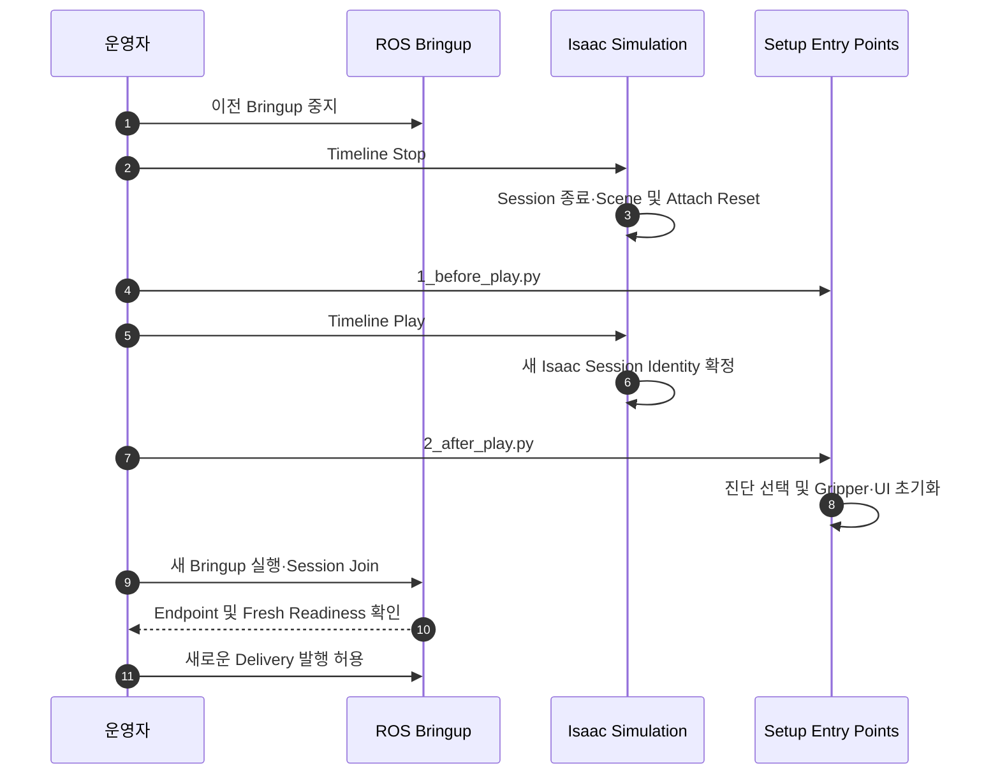

# [SF-Twin] ARM Cell Simulation Session 기능 설계 (FDS)

- **범위:** Isaac 개발용 Session Lifecycle
- **Owner:** ARM Cell Simulation Runtime(Isaac Simulation, `arm_cell_sim_adapter`, ROS Bringup)
- **관련 결정:** [ADR-ARM-CELL-0001](../../../record/architecture-decision/model-state-and-time.md)
- **공유 의미:** [Simulation State·Time·TF ICD](../../interfaces/icd-sim-state-time-tf.md)

## 1. 목적과 시퀀스

이 문서는 Pause/Resume·Timeline Stop·ROS Bringup 교체에 따른 **실험 Session Lifecycle**을 정의한다. Production Safety 메커니즘은 아니다.

## 2. Pause·Stop 및 실험 경계

Pause/Resume은 동일 Live Test Session이다. Pause 후 Timeline Play는 동일 Session을 재개하며 Session ID를 새로 할당하거나 Diagnostic Writer를 재생성하지 않는다. Timeline Stop은 현재 Session을 종료하고 기존 Isaac Reset Callback을 실행한다. Kit과 Stage는 Stage 자체가 변경되지 않은 한 열린 상태로 유지하면서 생성 Material·Gripper/Attachment·설정된 Robot HOME Target을 초기 Runtime 상태로 복원한다.

UI Hub의 Cuboid Demonstration도 Play-to-Stop 경계를 따른다. Playing Session당 성공 Load 한 번만 가능하며 Pause/Resume은 그 허용 상태를 보존한다. Stop은 Material Supply Reset으로 해당 RawPart를 제거하고 다음 Play에서 다시 Load를 허용한다. 이 로컬 자극은 Live Test Delivery/Admission 순서에 참여하지 않는다.

새 Live Test는 이전 ROS Bringup 중지 → Timeline Stop → `1_before_play.py` 설정 → Timeline Play로 Isaac 소유 새 Session 생성 → `2_after_play.py`로 Session 진단 선택·Gripper/UI Runtime 초기화 → 새 ROS Bringup이 Session 설명과 연결 → Endpoint 및 Simulation 의존 Fresh Readiness 확인 → 새 Delivery 순서로 실행한다. 새 Bringup이 준비되기 전에 작업을 승인하지 않는다. After Playing 시점이 Gripper Writer/PhysX Observer 생성보다 먼저 설정을 적용하고 ROS가 확인된 Session에 결합할 수 있도록 하는 순서다. Script Editor·ROS Bridge·Launch 세부 순서는 구현 관심사다.

Stop/Reset 후 Isaac은 기존 유한 Best-effort 경로로 Session Descriptor와 Diagnostic Producer를 Finalize한다. Descriptor는 확보 가능한 참여 프로세스별 Git Source Revision 및 Dirty State를 기록하고 누락 시 명시적 Unavailable로 남긴다. 출처를 얻지 못해도 Live Test나 Finalization을 막지 않는다. Stop은 Analysis/Report 프로세스를 실행하지 않고 보고서 작성을 Simulation Lifecycle에 포함하지 않는다. 종료 Session 분석은 별도 [Live Test Analysis FDS](../fds-live-test-analysis.md)와 분석 절차를 따른다. 분석은 기존 Producer Artifact를 제자리에서 읽으며 Runtime State나 원본 기록을 수정하지 않는다.

새 Bringup의 Gateway·Orchestration 프로세스 로컬 Accounting은 비어 있고 사용 가능한 명시적 Session ID로 현재 Isaac Session에 연결된다. Stop은 Isaac 소유 생성 Material·임시 Simulation State를 제거한다. Stage의 Delivery Prim은 Readiness나 성공 PLACE 이력을 증명하지 않는다. 성공 PLACE 이력은 보존된 Log/Diagnostic에 남고 다시 기록하지 않으며 이전 잔여 Workload는 새 프로세스의 실행 Quantity로 이월하지 않는다. Calibration·Recipe·유효 Configuration·Snapshot·Log는 보존한다. Isaac Python/Extension Reload는 별개의 In-process 작업이다.

## 3. Reset·Epoch 경계와 실패

운영자는 새 테스트 Session 전에 ROS Bringup을 중지하고 Timeline Stop을 수행한다. Stop은 현재 Session 및 Isaac 소유 상태를 종료·초기화한다. 다음 Timeline Play에서 새 Session을 열고 새 Bringup이 이를 연결한 후에만 작업을 승인할 수 있다. Reset 실패는 해당 Owner가 보고하며 새 Bringup 시작과 작업 승인 이전에 해결해야 한다. Session ID는 증거를 묶을 뿐 Runtime 작업의 Fence·승인 Authority가 아니다.

Isaac Reset은 멱등적이며 Fresh Gripper `RELEASED`나 실제 Safety Recovery를 요구하지 않는다. Simulation Attach 관계는 부착 Material을 삭제하기 전에 제거한다. Timeline Stop은 Safety StopMotion·Safety Reset을 실행하지 않는다. Bringup 교체에 Safety Latch/Cause Memory를 이관하는 계약은 없다. 새 Safety Process는 Fresh Input에 기존 정책을 적용하고 정상 Readiness Gate를 거쳐 Motion을 승인한다.

동일한 Playing Epoch에서 Timestamp Regression이 발생하면 다음 Timeline Stop→Play Reset 전까지 무효·Fail-closed로 남는다. Timestamp를 임의로 재기록하거나 Cached Data를 Replay하여 감추지 않는다.

## 4. 참여 책임 및 관측 의미

`arm_cell_sim_adapter`는 정규 Joint-state 발행과 실제 측정 상태 유효성을 소유하고 Isaac Simulation은 Timeline 및 Scene Reset을 소유한다. Simulation Runtime은 이들 Epoch 경계를 조정한다. Vision·Motion·Orchestration 등 Consumer는 명시적 Simulator Epoch 전환 시 **자신이 소유한 시간 의존 Cache와 대기 작업만** 정리한다. 다른 Consumer가 경쟁 Session Authority를 생성하지 않는다. Session/Time/TF 공유 필드의 의미는 [Simulation ICD](../../interfaces/icd-sim-state-time-tf.md)를 따른다.

## 5. Verification Requirements

### VR-SIM-TIME-01 — 단조 Pause/Resume
시간 역행이 없는 Pause/Resume은 정상적인 Session 참여 관계를 유지해야 한다.

### VR-SIM-TIME-02 — 새 Live Test Session
새 Session은 ROS Bringup 중지 → Timeline Stop/Reset → Before Playing Setup → Timeline Play → After Playing Session 초기화 → 새 ROS Bringup Session 연결 → Endpoint/Fresh Readiness 확인 → Work Admission 순서를 따라야 한다. 이전 프로세스 로컬 Workload/Readiness를 새 Session에 승인해서는 안 된다. Pause→Play는 기존 Session을 보존한다.

### VR-SIM-TIME-03 — 묵시적 시간 재기준화 금지
Epoch 변경을 Timestamp 재작성이나 Stale Cached State Replay로 숨겨서는 안 된다.

### VR-SIM-TIME-05 — 새 Isaac Session에 Bringup 연결
이전 Bringup 중지와 Timeline Stop으로 과거 Session을 정리한 뒤에도 Kit은 열려 있어야 한다. Timeline Play가 새 Isaac Session을 시작하고 After Playing 초기화가 새 Bringup 시작 전에 Session Descriptor를 제공해야 한다. 새 Bringup은 같은 Session에 연결하고 Fresh Endpoint를 확립해야 한다. 새 Delivery 전에 Fresh Simulation Observation/Readiness를 검증하며 이전 Delivery Accounting·Mission·Retry Budget·Pending Readiness·Action·Vision Result를 승계하지 않는다. Oracle은 Kit Process 연속성, Reset된 Stage Material, 새 Session ID, 가능한 경우 Isaac/ROS Session Record의 동일 ID, 구분되는 ROS Process/Goal/Acquisition ID, Fresh Endpoint 관측 및 신규 Admission 성공이다. 기존 Bringup을 유지한 Stop→Play는 이 절차 범위 밖이며 Session 연결 실패는 관측 가능하게 남되 Runtime 판단을 바꾸지 않는다.

### VR-OBS-SESSION-REVISION-01 — 참여 프로세스 소스 출처
Session Source Revision을 확보할 수 있으면 Session Descriptor에 참여 프로세스별 Revision·Dirty State를 기록해야 한다. 확보할 수 없다면 그 사실과 사유를 표현하되 Session Finalization을 차단해서는 안 된다. Oracle은 `session.json`의 프로세스별 출처 상관관계와 Unavailable 표시다.
