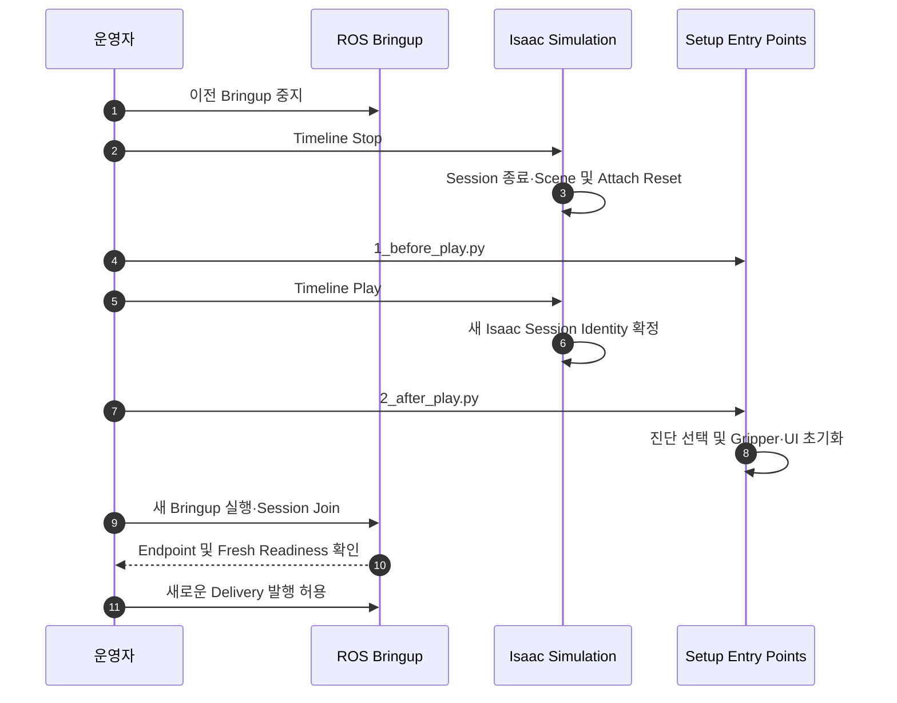

# [SF-Twin] ARM Cell Simulation Session 기능 설계 (FDS)

- **범위:** Isaac 개발용 Session Lifecycle
- **Owner:** ARM Cell Simulation Runtime(Isaac Simulation, `arm_cell_sim_adapter`, ROS Bringup)
- **관련 결정:** [ADR-ARM-CELL-0001](../../../record/architecture-decision/model-state-and-time.md)
- **공유 의미:** [Simulation State·Time·TF ICD](../../interfaces/icd-sim-state-time-tf.md)

## 1. 목적과 시퀀스

이 문서는 개발용 시뮬레이션의 실험 시작·종료와 운전 재개 조건을 정의한다. 아래 시퀀스는 Script Editor에서 Bringup을 수동 교체하는 경우다.

## 2. Pause·Stop 및 실험 경계

Pause/Resume은 동일 Live Test Session이다. Pause 후 Timeline Play는 동일 Session을 재개하며 Session ID를 새로 할당하거나 Diagnostic Writer를 재생성하지 않는다. Timeline Stop은 현재 Isaac Session을 종료하고 Isaac 소유 상태의 Reset Callback을 실행한다. Conveyor의 PLC 요청·공급 기록은 단순 Timeline 조작 뒤에도 대조할 수 있도록 보존한다. Kit과 Stage는 Stage 자체가 변경되지 않은 한 열린 상태로 유지하면서 생성 Material·Gripper/Attachment·설정된 Robot HOME Target을 초기 Runtime 상태로 복원한다.

UI Hub의 Cuboid Demonstration도 Play-to-Stop 경계를 따른다. Playing Session당 성공 Load 한 번만 가능하며 Pause/Resume은 그 허용 상태를 보존한다. Stop은 Material Supply Reset으로 해당 RawPart를 제거하고 다음 Play에서 다시 Load를 허용한다. 이 로컬 자극은 Live Test Delivery/Admission 순서에 참여하지 않는다.

Script Editor에서 수동으로 새 Live Test를 구성할 때는 이전 ROS Bringup 중지 → Timeline Stop → `1_before_play.py` 설정 → Timeline Play로 Isaac 소유 새 Session 생성 → `2_after_play.py`로 Session 진단 선택·Gripper/UI Runtime 초기화 → 새 ROS Bringup이 Session 설명과 연결 → Endpoint 및 Simulation 의존 Fresh Readiness 확인 → 새 Delivery 순서로 실행한다. 새 Bringup이 준비되기 전에 작업을 승인하지 않는다. After Playing 시점이 Gripper Writer/PhysX Observer 생성보다 먼저 설정을 적용하고 ROS가 확인된 Session에 결합할 수 있도록 하는 순서다. Script Editor·ROS Bridge·Launch 세부 순서는 구현 관심사다.

Stop/Reset 후 Isaac은 기존 유한 Best-effort 경로로 Session Descriptor와 Diagnostic Producer를 Finalize한다. Descriptor는 확보 가능한 참여 프로세스별 Git Source Revision 및 Dirty State를 기록하고 누락 시 명시적 Unavailable로 남긴다. 출처를 얻지 못해도 Live Test나 Finalization을 막지 않는다. Stop은 Analysis/Report 프로세스를 실행하지 않고 보고서 작성을 Simulation Lifecycle에 포함하지 않는다. 종료 Session 분석은 별도 [Live Test Analysis FDS](../fds-live-test-analysis.md)와 분석 절차를 따른다. 분석은 기존 Producer Artifact를 제자리에서 읽으며 Runtime State나 원본 기록을 수정하지 않는다.

새 Bringup의 Gateway·Orchestration 프로세스 로컬 Accounting은 비어 있고 사용 가능한 명시적 Session ID로 현재 Isaac Session에 연결된다. Stop은 Isaac 소유 생성 Material·임시 Simulation State를 제거한다. Stage의 Delivery Prim은 Readiness나 성공 PLACE 이력을 증명하지 않는다. 성공 PLACE 이력은 보존된 Log/Diagnostic에 남고 다시 기록하지 않으며 이전 잔여 Workload는 새 프로세스의 실행 Quantity로 이월하지 않는다. Calibration·Recipe·유효 Configuration·Snapshot·Log는 보존한다. Isaac Python/Extension Reload는 별개의 In-process 작업이다.

## 3. Reset·Epoch 경계와 실패

### 런처에서 새 실험 시작

**Initialize**는 Setup에 선택된 구성으로 로컬 시뮬레이션을 원점에서 다시 시작하는 요청이다. 실패한 작업, 응답 대기 중인 PLC 요청, 남은 자재 또는 그리퍼가 자재를 든 상태에서도 접수한다. 런처는 현재 Kit 프로세스와 창을 유지한다. 초기화 중에는 신규 운전·공급 요청을 보류하고, 이전 작업과 설비 연결이 새 장면에 명령이나 결과를 적용할 수 없게 한 뒤 각 참여자가 소유한 상태를 복원한다.

완료 시 로봇은 설정된 HOME, Tool과 가상 설비는 초기 상태이며, 활성 자재·예약·대기 공급·실행 중인 작업은 없다. Conveyor의 Initialize는 PLC의 공정 원점 확인과 Adapter의 영수증 원점 확인이 [Adapter가 식별한 같은 새 요청 스트림](../../interfaces/icd-plc-task.md#새-요청-스트림과-영수증)에 속하는지 확인한다. 이전 실험의 영수증·생산·진단 이력과 배포 설정은 보존한다. 일부 참여자의 응답이 지연되면 초기화 진행 상태를 유지한다. 런처는 같은 요청에서 연결과 원점 확인을 자동으로 재시도한다. 운영자가 다시 누를 필요가 없으며 초기화가 끝난 Cell은 일시정지 상태에서 명시적인 Start를 기다린다.

Isaac, ROS Bringup, PLC Runtime은 독립적으로 기동할 수 있다. 초기화 완료는 선택된 Cell의 참여자가 새 실험에 연결되어 원점을 확인한 시점이다. 개별 동작은 해당 시점의 설비·로봇 관측과 공정 허가에 따라 수락한다. Live Test Session ID는 진단 기록의 상관관계를 나타낸다. 실제 장비의 복구·Safety Reset은 각 장비와 Safety Owner의 계약을 따른다.

Isaac Reset은 멱등적이며 Fresh Gripper `RELEASED`나 실제 Safety Recovery를 요구하지 않는다. Simulation Attach 관계는 부착 Material을 삭제하기 전에 제거한다. Timeline Stop은 Safety StopMotion·Safety Reset을 실행하지 않는다. Bringup 교체에 Safety Latch/Cause Memory를 이관하는 계약은 없다. 새 Safety Process는 Fresh Input에 기존 정책을 적용하고 정상 Readiness Gate를 거쳐 Motion을 승인한다.

동일한 Playing Epoch에서 Timestamp Regression이 발생하면 다음 Timeline Stop→Play Reset 전까지 무효·Fail-closed로 남는다. Timestamp를 임의로 재기록하거나 Cached Data를 Replay하여 감추지 않는다.

## 4. 참여 책임 및 관측 의미

참여자는 실행에 실제 적용한 설정을 불변 Snapshot과 내용 Hash로 세션에 연결한다.
시뮬레이션 시작 설정, ROS Bringup 설정 및 세션 중 적용된 티칭 변경을 생산자와 적용 사건별로
구분한다. 현재 파일 경로·Git Revision만으로 과거의 적용값을 대신하지 않는다. 설정 기록 실패나
이력 한도는 관측 가능한 진단 제한으로 남으며 실행 수락·종료를 바꾸지 않는다.

`arm_cell_sim_adapter`는 정규 Joint-state 발행과 실제 측정 상태 유효성을 소유하고 Isaac Simulation은 Timeline 및 Scene Reset을 소유한다. Simulation Runtime은 이들 Epoch 경계를 조정한다. Vision·Motion·Orchestration 등 Consumer는 명시적 Simulator Epoch 전환 시 **자신이 소유한 시간 의존 Cache와 대기 작업만** 정리한다. 다른 Consumer가 경쟁 Session Authority를 생성하지 않는다. Session/Time/TF 공유 필드의 의미는 [Simulation ICD](../../interfaces/icd-sim-state-time-tf.md)를 따른다.

## 5. Verification Requirements

각 VR 아래 표의 행은 같은 기존 VR의 확인 항목이다. 행 전체가 해당 ID의 검증 범위를 구성하며 별도 Claim ID를 만들지 않는다.

### VR-SIM-TIME-01 — 단조 Pause/Resume
시간 역행이 없는 Pause/Resume은 정상적인 Session 참여 관계를 유지해야 한다.

### VR-SIM-TIME-02 — 새 Live Test Session
수동 경로는 §1의 순서로 동작한다. 런처 경로에서는 직전 작업이 실패해 그리퍼와 슬롯에 잔류 상태가 있거나 PLC와 Adapter가 서로 다른 마지막 요청 번호를 기억할 때 Initialize를 요청한다. Kit과 창이 유지되고, 양측의 새 원점이 확인된 뒤에만 Start가 가능해야 한다. 이전 작업의 늦은 응답은 새 원점을 바꾸지 않으며, 일부 참여자의 복원이 지연되어 같은 초기화를 다시 요청해도 공급이나 PnP가 발생하지 않는다. Pause→Start는 기존 실험과 잔량을 보존한다.

### VR-SIM-TIME-03 — 묵시적 시간 재기준화 금지
Epoch 변경을 Timestamp 재작성이나 Stale Cached State Replay로 숨겨서는 안 된다.

### VR-SIM-TIME-05 — 새 Isaac Session에 Bringup 연결

| 검증 관점·조건 | 기대 결과·금지 결과 및 관찰 근거 |
|---|---|
| 과거 Session 정리 | 이전 Bringup 중지와 Timeline Stop으로 과거 Session을 정리한 뒤에도 Kit은 열려 있어야 한다. |
| 새 Session·Descriptor | Timeline Play가 새 Isaac Session을 시작하고 After Playing 초기화가 새 Bringup 시작 전에 Session Descriptor를 제공해야 한다. |
| 새 Bringup 연결 | 새 Bringup은 같은 Session에 연결하고 Fresh Endpoint를 확립해야 한다. |
| 새 Delivery 준비 | 새 Delivery 전에 Fresh Simulation Observation/Readiness를 검증하며 이전 Delivery Accounting·Mission·Retry Budget·Pending Readiness·Action·Vision Result를 승계하지 않는다. |
| 관찰 근거 | Oracle은 Kit Process 연속성, Reset된 Stage Material, 새 Session ID, 가능한 경우 Isaac/ROS Session Record의 동일 ID, 구분되는 ROS Process/Goal/Acquisition ID, Fresh Endpoint 관측 및 신규 Admission 성공이다. |
| 수동 Bringup 교체 | 기존 Bringup을 유지한 Stop→Play는 수동 교체 검증 범위 밖이며 Session 연결 실패는 관측 가능하게 남되 Runtime 판단을 바꾸지 않는다. |

### VR-OBS-SESSION-REVISION-01 — 참여 프로세스 소스 출처
Session Source Revision을 확보할 수 있으면 Session Descriptor에 참여 프로세스별 Revision·Dirty State를 기록해야 한다. 확보할 수 없다면 그 사실과 사유를 표현하되 Session Finalization을 차단해서는 안 된다. Oracle은 `session.json`의 프로세스별 출처 상관관계와 Unavailable 표시다.
