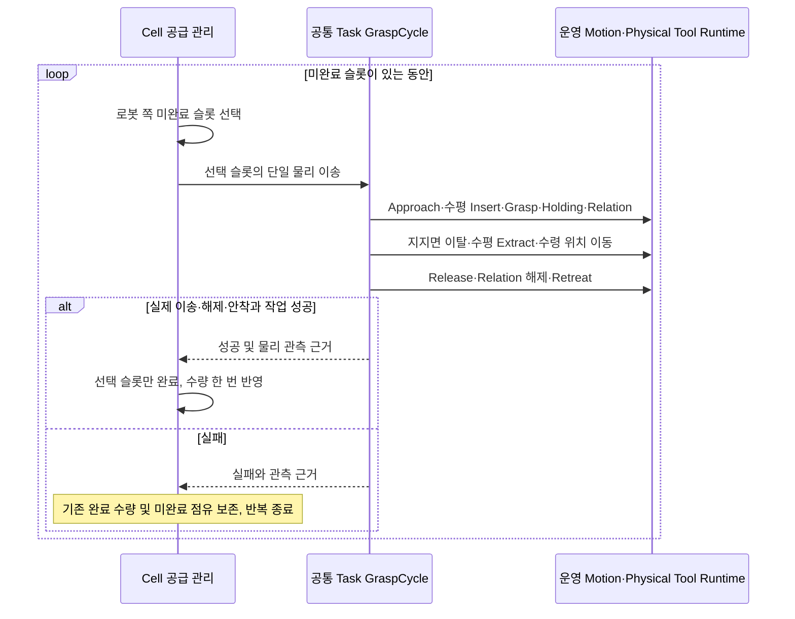

# Tape Handling Cell 공급·물리 이송 FDS

- **Function ID:** Tape Cell Cartridge Processing
- **Owner:** Tape Cell Simulation 공급 관리

## 목적과 동작 범위

선택된 Tape Cell의 정렬된 카트리지 자재를 한 슬롯씩 공통 Task Execution에 맡겨 수령 위치로 옮기고,
확인된 물리 이송·해제만 공급 완료 수량에 반영한다. 시작은 명시적인 Cell 실행 요청이며,
종료는 공급 소진 또는 첫 실패다. ROS Mission Admission·Safety 승인·Motion 계획은 해당 Owner가 수행한다. 정렬 슬롯은 Vision 관측과 다른 typed 작업 원천이다.

## 참여 책임과 계약

| 참여 책임 | 역할 | 관련 계약 |
|---|---|---|
| Cell 공급 관리 | 슬롯 배치·선택, 슬롯 점유·완료 수량, Stop 복원 | 이 FDS |
| Material | 중공 롤 치수·질량·마찰·관성·Collision 형상 | Material Profile 및 [환경 의미](../simulation-environment-semantics.md) |
| Task Execution | 단일 자재 GraspCycle 순서와 terminal 결과 | [Task Execution CDS](../task-execution/cds.md) |
| Tool Runtime | Internal Radial Grasp 구동·Holding·Release 관측 | [Motion Backend ICD](../../interfaces/icd-motion-backend.md) |
| Simulation | 중력·접촉에 의한 물리 이송, Timeline lifecycle | [Simulation Session FDS](fds-sim-session.md) |

## 핵심 시나리오

Cell은 위치·지지면·티칭을 소유한다. Robot·Tool·Assembly 설정의 관절과 TCP 의미를 바꾸지 않는다.
슬롯 좌표에 대한 티칭은 선택 기구학의 FK·IK로 검증하고, 실제 경로의 접촉·충돌은 물리 실행으로 검증한다.
수령 위치는 이전 완료 자재가 다음 Tool 삽입 통로를 막지 않는 순서로 사용한다.

## 상태·실패·복원

미완료 슬롯은 선택할 수 있으며, 한 번에 하나만 활성화한다. 완료는 활성 슬롯의 실제 이송과 물리 Release,
수령 위치 안착이 확인된 뒤에만 가능하다. Tool 명령 수락·BT 반환·Relation 생성만으로 차감하지 않는다.
동일 예약의 완료 재확인은 수량을 중복 차감하지 않는다. 공급 소진 시 새 작업을 시작하지 않는다.

실패는 물체를 원래 위치로 되돌리지 않고 실행을 종료한다. 공급 점유는 미완료 기록이며 물체의 실제 위치를
보장하지 않는다. 실패 원인과 종료 전 물리 상태·수량을 보존하며 자동 재시도하지 않는다.
Playing 동안 강제 Attach·물체 pose/velocity 재설정·중력 또는 Collision 해제로 성공을 만들지 않는다.

Timeline Stop은 종료 상태 기록 뒤 Cell의 초기 카트리지 배치·물체 속도·공급 상태를 함께 복원한다.
이 복원은 성공 이력을 새 완료 수량으로 이월하지 않는다. Pause는 초기화 조건이 아니다.

## 실행 범위

Cell 선택·Scene Builder·Tool bootstrap은 공통 Runtime Workflow의 Plugin 경계를 사용한다.
M0609 + C10/Long은 정식 Physical Real 모드이며 운영 ROS Backend·Task/Mission으로 실행한다.
Orchestration의 configured source는 [Configured Supply ICD](../../interfaces/icd-configured-supply.md)의 예약을 사용한다.
Vision source의 Acquisition을 생성하거나 검출 성공을 합성하지 않는다. CNC Cell과 2F-85의 동작은 유지한다.

Robot HOME 초기화는 정지된 Scene 준비다. HOME에서 Cell 진입점까지는 Motion이 실제 Scene을 사용해
전역 계획한다. Cartesian 티칭 구간은 구간 FK·관절 제한·시간 매개화·충돌 검사를 통과해야 하며,
관절/Clock 관측으로 실행 결과를 확인한다. Physics Scene의 Attach·중력·충돌 설정을 성공 판정에 맞춰 바꾸지 않는다.

## Verification Requirements

| ID | 조건·자극 | 관찰 가능한 기대 결과·금지 결과 |
|---|---|---|
| VR-TAPE-SUPPLY-01 | 기본 17 mm 롤 3개 연속 처리 | 각 슬롯에서 수평 삽입·물리 파지·지지면 이탈·이송·해제·후퇴, 수량 1→2→3 및 소진 |
| VR-TAPE-SUPPLY-02 | 슬롯별 실행 및 실패 | Robot/설비·비핑거/롤·미선택 롤 접촉은 실패, 실패한 슬롯을 완료로 반영하지 않고 이전 수량 보존 |
| VR-TAPE-SUPPLY-03 | 처리 또는 실패 뒤 Timeline Stop | 모든 롤이 초기 슬롯 배치·정지 속도로 복원, 완료 0·전체 미완료, Pause에는 보존 |
| VR-TAPE-SUPPLY-04 | 기본 C10 및 기존 Cell/Tool 회귀 | 기본 C10의 같은 운영 ROS 물리 공정과 CNC·2F-85 관련 기존 동작 보존, 시험 Adapter 없이 실제 Task/Mission 실행 |
| VR-TAPE-SUPPLY-05 | 정식 Launcher 및 configured-source Mission | 실험 전용 제어 없이 Physical Real 선택, 실제 슬롯 예약·Task·수령 확인, Safety/공급 신선도 손실 시 중단, Vision 성공 합성 금지 |
