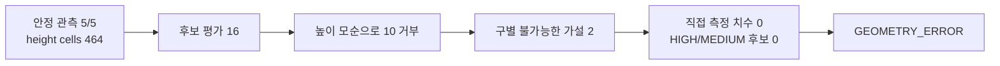
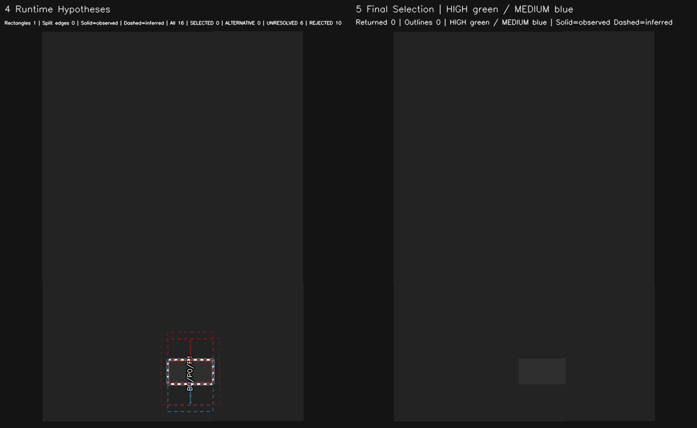

# 공장 환경의 기하학적 제약을 활용한 결정론적 Vision 설계

*Engineering Story — 설계자의 2026-10-30 회고와 GitHub PR 이력을 함께 정리한 역사적 기록. 현재 알고리즘 계약, Acceptance Report 또는 성능 Benchmark를 대체하지 않는다.*

## 설계 문제와 원래 의도

ARM Cell의 RawPart 검출에서 설계자의 핵심 목표는 **Geometry 기반 검출 자체**였다. 단순히 학습 모델 사용을 회피하려는 것이 아니라, **공장용 로봇이라는 도메인의 특성—알려진 자재 치수, 제한된 작업 영역, Tray 기준면, RGB-D 관측 조건—을 적극 활용하여 결정론적이고 안정적인 기능을 구현**하려는 판단이었다. 이 의도는 설계자의 직접 회고에 근거한다.

**적용 범위:** 이 목표는 모든 환경에서 학습 기반 Vision보다 우수하다는 주장이 아니다. 여기서 결정론적이란 알려진 입력·기하학·허용 오차·선택 규칙으로 결과를 설명하고 디버깅할 수 있도록 설계했다는 의미다. 센서 잡음이나 가림 때문에 모든 장면에서 검출이 성공한다거나, 동일한 실제 장면에서 관측값까지 완전히 일치한다는 보장은 아니다.

## 선택한 접근과 책임 경계

초기 Geometry-first 판단은 [기존 Algorithm Record](../algorithm-decision/vision-detection-01.md)에 정리돼 있다. RGB의 ArUco 관측은 기준면 설정에 사용하고, 자재 검출은 Depth에서 얻은 3D·높이·외곽선과 알려진 RawPart 치수로 수행한다. 시뮬레이터 내부의 USD Prim 또는 Ground Truth를 실측 Vision 입력처럼 사용하지 않는다.

이 선택은 시스템 전체를 특정 검출기에 고정한다는 뜻이 아니다. [Detector Replaceability 결정](../architecture-decision/vision-detector-replaceability.md)은 외부 DetectTarget 의미 계약과 내부 검출 전략을 분리했다. 현재 자재와 공장 환경에는 Geometry-first가 적합하다고 판단하면서도, 다른 Target에 학습 기반 전략을 도입할 가능성은 열어 둔 것이다.

## 관측이 어려워지면서 발전한 알고리즘

1. **완전 관측에서 부분 관측으로.** 초기 구현은 완전하게 관측되는 형상 검출에 집중했다. 설계자는 당시 가려진 자재의 *확정적인* 복원은 어렵다고 판단했다. 이후 라이브 테스트에서 가림으로 인해 검출되지 않는 자재가 PnP 흐름을 방해하는 문제를 확인했다. 검출 알고리즘이 관측 외곽선의 직각 개수와 L·ㄷ·ㅁ자 등의 구조를 활용하도록 발전하면서, 부분 관측만으로도 신뢰할 수 있는 형상 가설을 구성할 수 있다고 판단해 복원 기능을 추가했다. 목적은 부분 복원 자체가 아니라 자재 처리의 원활한 연속성이었다. 이는 설계자의 후속 회고에 근거하며, 관련 구현·계약 발전은 PR #681 등에서 확인할 수 있다.
2. **Height Patch 전체 판정의 한계.** 수평면에 경사면이 연결되면 연결된 패치 전체를 한 번에 수평성 검사하여 유효 경계를 잃을 수 있었다. PR #689, PR #690은 경계를 먼저 보존하고 Plane Map에서 평면을 구분한 뒤 객체 가설을 해석하도록 처리 순서를 바꿨다.
3. **관측과 추론을 구분.** 실제 측정된 경계·지지 셀과 가정으로 복원한 영역을 구분하며, 독립적인 객체와 상충하는 가설을 별도로 취급한다. 불분명한 해석을 무조건 하나의 확정 정답으로 표현하지 않는다. 이는 결정론적 규칙을 사용하더라도 관측 자체의 불확실성은 남겨야 한다는 교훈이다.
4. **검출과 계획의 책임 분리.** 이전에는 Vision에서 후보별 Planning Occupancy를 구성했지만 PR #735에서 Vision은 관측된 후보 Geometry를 반환하고, Motion은 현재 선택 후보를 제외한 다른 후보로 요청별 Planning Scene을 구성하도록 바꿨다. Geometry-first 검출을 유지하면서도 계획 목적의 변환 책임을 올바른 소비자로 옮긴 것이다.

## 얻은 교훈

공장 환경의 제약은 범용 인식 문제를 **측정 가능한 물리적 근거와 검증 가능한 기하학 가설의 문제**로 좁혀 준다. 알고리즘이 복잡해지더라도 측정 데이터, 가설 생성, 상충 해석 선택, Motion의 실행 가능성 판단을 구분하는 것이 중요했다. 필요 이상의 불확실성 차단 Gate를 도입하는 대신 무엇을 실제로 관측했는지 남기는 진단이 설계 의도와 잘 맞는다.

## 저장된 정량 관측과 경계

2026-10-26 라이브 세션 `cff28c9c-b16a-4b7a-ab8c-582386b9706f`의 네 Vision Acquisition 기록(acq-1, 2, 3, 5)은 각각 부분 형상 복원을 선택했고 `DETECT_RESULT_SUCCESS`를 기록했다. 이 네 기록에서 Detector 처리시간은 466.817–976.319 ms, Vision 전체 처리시간은 753.8–1777.1 ms였다(n=4, 단위 ms). 이는 해당 세션에서 선택된 성공 기록의 관측 범위이지, 모든 Acquisition의 성공률이나 변경 전후 속도 향상을 뜻하지 않는다. 실행 revision은 `cc418448de129899b9469f54f773066076d1eb9b`(clean), Profile 파일 SHA-256은 `450682badbdaab65983bcbd321eaf672c0c6069911c9090eb9ec67245a677044`였다. 원본은 `private local diagnostic artifact (not included in the public package){1,2,3,5}.json`이다.

### 처리시간 관측 (n=4, 선택된 부분 복원 성공 기록만)

| 측정 범위 | 표본 수 | 최소–최대 |
|---|---:|---:|
| Detector 처리 | 4 | 466.817–976.319 ms |
| Vision 전체 처리 | 4 | 753.8–1777.1 ms |

두 시간 범위는 각각 같은 네 Acquisition 기록에서 관측한 값이며, 평균·개별 실행 시간·변경 전후 개선량을 뜻하지 않는다.

### 동일 세션의 Snapshot 예시

*Image omitted from public export: 2026-10-26 세션 acq-1의 geometry candidate Snapshot*

*세션 `cff28c9c-b16a-4b7a-ab8c-582386b9706f`의 acq-1 저장 Snapshot. 처리시간 집계 표본과 같은 세션의 시각 자료이며, 이미지 자체는 별도 측정 표본이 아니다.*

### 모호성 사례의 관측 흐름

*acq-13의 로컬 Snapshot을 PR에 표시할 수 있도록 원본을 복사해 첨부했다. 원본은 `private local diagnostic artifact (not included in the public package)`이며 수정하지 않았다.*

반례도 있다. 라이브 보고서 2026-10-28 Grasp Analysis의 세션 `2c1391bf-c6da-4458-baa2-ca994f1f47f3`에서 acq-13은 5/5 안정 관측과 464 height cells, 16 candidate evaluation을 기록했으나, 측정 높이와 모순되어 10개 후보를 거부하고 구별 불가능한 두 가설을 남겼다. 직접 관측 치수는 0, HIGH/MEDIUM 후보도 0이었으며 결과는 `GEOMETRY_ERROR`였다. 이는 부분 관측의 모호성을 성공적인 형상 복원으로 세지 않은 사례다. 해당 실행 revision은 `e9be1538606191e6154f7cfc5cea5376a21a3e41`(clean)이다. 서로 다른 세션·Acquisition이므로 두 관측을 비교 성능 표본으로 취급하지 않는다.

## 정량 비교가 남은 부분과 후속 질문

- 설계 의도: 개발자 직접 회고(2026-10-30).
- 구현과 계약 변화: PR #681, PR #689, PR #690, PR #735.
- 관련 선행 기록: [Geometry-first 검출 선택](../algorithm-decision/vision-detection-01.md), [검출 전략 교체 가능성](../architecture-decision/vision-detector-replaceability.md).
- 이 기록은 버전별 정량 검출 성능 비교를 주장하지 않는다. 저장된 Acquisition Replay 및 라이브 세션을 같은 지표로 대조하기 전에는 성공률, 속도, 안정성 향상률을 확정할 수 없다.
- **설계자 후속 회고(2026-10-30):** 초기에는 완전 형상 검출에 집중했으며, 가림 복원의 신뢰성을 회의적으로 보았다. 라이브 테스트에서 필요성을 발견하고 직각 형상 기반 추론이 성숙한 후 PnP 연속성을 위해 확장했다.
