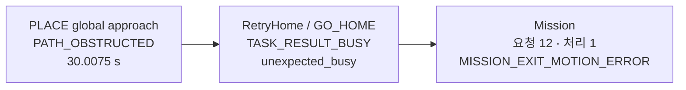

# 실패를 복구 가능한 작업 과정으로 재해석하고 상태 소유권을 정리한 과정

*Engineering Story — 2026-10-30 개발자 회고와 GitHub 이력 대조. 역사적 판단 근거를 보존하며 현재 Safety·Motion·Task Execution·Orchestration 계약이나 Acceptance Report를 대체하지 않는다.*

## 시작점과 설계 판단

ARM Cell 개발 과정에서 검출 실패, IK 해 탐색 실패, 계획 실패, 일시적인 관측 지연은 반복적으로 나타났다. 초기 구현에서 이런 사건이 곧바로 Motion 또는 Mission의 terminal 실패가 되거나 별도 Gate에 의해 진행이 막히면, 물리적으로 작업을 계속할 수 있어도 전체 자재 처리가 중단될 수 있었다.

개발자가 직접 밝힌 설계 의도는 두 가지다.

1. **검출·IK·경로 계획 실패를 산업용 로봇 작업에서 발생할 수 있는 정상적인 시행착오로 보고 가능한 범위에서 복구와 작업 완료를 추구한다.**
2. **일시적인 관측 오류와 실제 시스템 고장을 구분해 불필요한 차단을 없앤다.** 단, 이 원칙은 필수 Safety나 물리적으로 정당한 동작 조건을 건너뛰자는 뜻이 아니다.

실패·복구 디버깅 과정에서 또 하나의 구조적 문제가 드러났다. **각 컴포넌트의 상태값 소유권이 모호할 때 유사한 상태가 중복 생성되고 서로 충돌하거나 꼬였다.** 책임 분리는 단순히 Orchestration의 코드량을 줄이려는 것이 아니라, 어느 컴포넌트가 어느 사실을 확정하는지 분명히 하려는 설계 결정이었다. 이 인과 관계는 개발자의 2026-10-30 회고에 근거한다.

## 확인된 변화

### 1. 관측과 고장을 분리

PR #443은 Motion Action 중 Feedback이 일시적으로 누락돼도 누락만으로 취소하거나 재제출하지 않고, 500ms 주기 Feedback과 Orchestration의 침묵 진단을 구분했다. PR #574는 500ms JointState 공백을 즉시 `STALE_FEEDBACK` terminal로 처리하지 않고 WARN으로 기록하며 관측이 돌아온 뒤 유효한 측정값으로 판정하도록 바꿨다. 관측이 없는 상태를 성공이나 물리적 정지의 증거로 간주하지 않는 조건은 유지했다.

### 2. 명령 완료와 목표 정확도의 의미를 구분

PR #457 및 PR #455는 정상적으로 실행된 PICK/PLACE Trajectory가 잔여 목표 오차만으로 실패 취급되지 않게 실행 완료와 정확도 진단을 구분했다. 이후 PR #707에서 실행 중 관절 안정화 대기가 완료를 막는 문제를 재검토해 명령 수락·Simulation Time·무효화 조건을 중심으로 완료 계약을 수정했다. 이는 모든 오류 검사를 없애려는 변경이 아니라 **실행 판단, 정확도 관측, 감시 Watchdog의 책임을 분리**한 사례다. 자세한 이력은 Motion 완료 의미 기록에 있다.

### 3. 실패 이후 자재 상태를 명시하고 새 작업으로 재진입

PR #614는 PICK·PLACE와 반환 상황에 `UNCHANGED`, `HELD`, `RETURNED`, `PLACED`, `UNKNOWN` 등의 `object_disposition` 의미를 정리했고, PR #616은 완료되지 않은 작업의 반환과 새 Vision Acquisition·새 Motion Goal 재진입을 구현했다. RELEASED 이후 실제 배치된 자재는 후속 Retreat 실패와 무관하게 처리 수량에 반영해야 하며, 반대로 반환한 자재는 배치 성공으로 계산하지 않는다. 이를 통해 **실패한 동작과 이미 확정된 공정 진전**을 구분했다.

### 4. 중복·잔류 실행 상태가 복구를 방해한 사례

PR #716에 기록된 2026-10-28 17:17 진단(세션 `a5d95366-ffe5-456d-81e4-31a49a07815f`, clean revision `ed46297a26abd35ecabcdd022101c2ce0b123cc8`)에서 PLACE `place_global_approach` 계획은 `TASK_RESULT_PATH_OBSTRUCTED`로 끝났고 executor elapsed는 30.0075 s였다. 이어 Orchestration의 RetryHome GO_HOME 요청은 `TASK_RESULT_BUSY`, `reason=unexpected_busy`, `failure_stage=execution:go_home_backend_request`로 거부됐다. 해당 Mission은 quantity 12 요청 중 1개 처리 후 `MISSION_EXIT_MOTION_ERROR`였다. 즉, 진단 기록은 planning-only 실패 후 복구 요청이 busy로 차단된 실제 순서를 특정한다. 원본은 `private local diagnostic artifact (not included in the public package)`의 session, Motion 및 Orchestration 기록이다.

PR #716은 planning-only 실패의 operation 상태 정리 동작을 수정했지만, 위 세션은 수정 전 진단이며 이 기록에서 같은 라이브 조건의 수정 후 복구 결과는 확인되지 않았다. 따라서 이는 원인 특정 사례이지, 수정의 라이브 성공률 또는 복구 개선량 증거가 아니다.

### 세션 내 실패 순서

시간은 실패한 PLACE planning executor의 측정값이다. 복구 GO_HOME은 `BUSY`로 거부되어 실행 시간/복구 성공 시간이 기록되지 않았다.

진단은 PLACE planning-only 실패에서 이전 operation의 `backend_inactivity_confirmed=false` 상태가 남아 새 요청의 예약 해제를 방해한 것으로 원인을 좁혔다. PR #716은 실제 실행이 시작되지 않은 planning-only 실패의 operation 상태를 정리하도록 바꾸되, 실행 중이거나 Cancel/Safety stop이 미확정일 때의 Busy/Stop 경계는 유지했다. 이 기록에서 수정 후 동일 조건의 라이브 결과는 확인되지 않았다.

### 5. 복구 동작을 재사용 가능한 단계로 구성

PR #746은 E-Stop Reset 후 HELD 자재를 다시 PICK하는 대신 Tray에 반환하는 `ReturnHeldToTray` Action을 도입하고 PLACE 실패 복구에서도 재사용했다. 단 해당 PR은 반환 실패를 무조건 자동 재시도하지 않는다고 명시한다. 따라서 *가능한 한 작업 완료*라는 상위 목표와 *모든 오류의 무제한 재시도*는 같은 의미가 아니다.

## 상태·판단의 소유권

- **Safety:** Stop severity, Safety latch 및 Reset 권한, 동작 허가.
- **Motion:** 개별 movement의 실행·완료와 backend 상태, 관절 관측, 결과 및 장치·Holding 관측.
- **Task Execution:** PICK/PLACE 내부 단계, 반환·복구 시퀀스, 자재 disposition과 PnP 결과.
- **Orchestration:** Mission 진행, 새 Acquisition을 포함한 상위 재진입 및 수량 반영.

이는 이미 존재하는 [분산 상태 권한 ADR](../architecture-decision/distributed-state-authority.md)을 반복해서 새로운 규범으로 선언하는 것이 아니라, *실패와 복구를 디버깅하는 동안 그 책임 경계의 필요성이 드러난 과정*을 연결한 기록이다. 실제 의미 필드의 현재 소유자와 세부 전이는 최신 CDS/FDS/ICD를 따른다.

## 회복력을 높이면서 포기하지 않은 조건

- 일시적 피드백 공백은 로그·진단 대상이지만, 그것만으로 물리적 안전과 완료를 단정하지 않는다.
- IK/Planning 후보 실패는 적절한 후보·상태·예산 안에서 다음 시도 또는 재취득으로 연결할 수 있으나, 실패 원인을 성공으로 바꾸지 않는다.
- Safety Stop, Cancel, Backend 미정리 상태 및 필수 실행 조건은 복구 과정에서도 보존한다.
- **Retry와 Recovery는 다르다.** 반복 횟수·재진입·종료 조건은 현행 계약에서 확인해야 한다. Engineering Robustness Policy는 무제한 Retry를 허용하지 않으므로, 과거의 '계속 재시도'라는 개발 방향을 현행 전역 무제한 Retry 보장으로 표기하지 않는다.

## 확인된 변화와 정량 비교가 남은 부분

각 PR은 해당 단계의 빌드·회귀 또는 정적 검증을 제시하지만 이 기록에서 제시한 여러 변경을 하나의 통제된 전후 실험으로 검증한 자료는 아니다. 따라서 미션 완료율 상승, 평균 복구 시간 단축 등 정량적 효과는 주장하지 않는다. 확인 가능한 결론은 **실패가 발생했을 때 관측·상태·자재 처분·복구 책임을 분리하며 구현과 디버깅의 인과관계가 더 명확해지도록 발전했다**는 것이다.

## 후속 증거

- PR #443, PR #455, PR #457, PR #574, PR #614, PR #616, PR #707, PR #716, PR #746.
- 실측 비교가 필요하다면 복구 전후 Live Session의 Motion terminal, Mission result, 상태 전이, 진단 Snapshot을 동일한 기준으로 연결해야 한다.
