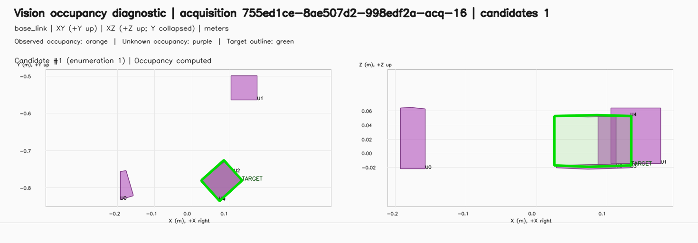

# Depth 셀 점유 근사에서 검출 객체 기반 Motion Occupancy로 전환한 과정

*Engineering Story — 2026-10-30 설계자 회고와 PR #734·#735, 현행 Vision/Motion 설계 대조. 역사적 설계 판단이며 현재 충돌 검사 계약이나 Acceptance Report를 대신하지 않는다.*

## 출발점: 사용 주체는 Motion이지만 데이터 원천은 Vision이었다

충돌맵은 원래 Motion의 경로 계획에서 주로 사용하는 정보라는 점을 설계자는 처음부터 알고 있었다. 그러나 충돌맵을 구성하려면 카메라의 Depth Map이 필요하다고 판단했고, 따라서 **Vision 내부에서 점유 객체를 셀 단위로 근사해 생성하는 것이 불가피하다**고 생각했다. 이 초기 배치는 단순한 책임 실수가 아니라, 원시 관측 데이터에 접근해야 한다는 기술적 제약을 고려한 판단이었다.

이 맵의 중요한 목적은 **작업 과정에서 이미 검출된 다른 자재의 상태를 불필요하게 손상시키지 않는 것**이었다. 그것을 현장 안전 장치의 대체 수단으로 보거나, 모든 미검출 공간을 위험 공간으로 차단하는 안전 경계로 설계하려던 것은 아니었다. 이 목적 구분은 설계자의 2026-10-30 직접 회고에 근거한다.

## 문제: 보수적 셀 점유 근사가 유효한 파지 가능성을 제거

Depth Map의 셀 단위 관측을 점유 객체의 근사 형상으로 만드는 동안 실제 객체보다 넓거나 부정확한 충돌 영역이 나타났고, 정상적으로 파지할 수 있는 후보가 충돌 판정으로 거부되는 일이 반복됐다. 이는 단순히 파라미터를 더 보수적으로 잡으면 해결되는 종류의 문제가 아니라, **검출된 자재를 보존하는 목적과 관측되지 않은 영역을 광범위하게 점유로 취급하는 표현 방식 사이의 불일치**였다.

설계자는 디버깅을 통해 다음과 같이 전제를 수정했다. 공장용 RawPart 작업에서 이미 검출된 객체의 기하학과 Pose가 확보된다면, Motion은 그 정보를 사용해 현재 선택한 Target을 제외한 나머지 검출 객체의 점유 형상을 구성할 수 있다. 따라서 충돌맵 생성을 위해 Vision이 항상 원시 Depth 셀을 직접 해석해야 하는 것은 아니다.

## 결정: 검출 객체 Geometry는 Vision, 요청별 Planning Occupancy는 Motion

PR #734는 설계 책임을 정리했다. Vision은 Candidate Pose·Geometry·provenance를 제공하고 Task Execution은 동일 Acquisition의 후보 목록과 선택 Candidate ID를 전달한다. Motion이 이 정보로 **선택 Target 이외의 유효한 검출 후보에 대한 BOX Occupancy**를 생성해 요청별 Planning Scene에 적용하도록 했다.

PR #735는 해당 구조를 구현했다. Vision의 후보별 점유 생성·분해·Target 차감 기능을 제거하면서도 후보 Geometry와 미해결 형상에 대한 진단 근거는 보존했다. Motion은 각 후보 시도에서 선택 Target을 제외한 후보의 Geometry를 사용한다. Snapshot 역시 실제 요청 Planning Map과 동일한 Occupancy 근거를 기록한다.

**미검출 영역은 이 PICK Collision Occupancy에 포함하지 않는다.** 이는 알려진 RawPart 작업 환경과 검출 객체 보호라는 목적에 따른 적용 범위이며, 미검출 영역의 물리적 빈 공간을 증명하는 것은 아니다. 현재 RawPart 작업의 알려진 객체·작업 환경 가정 아래, 확실하게 검출된 자재를 보호하는 목적에 맞춰 계획 점유 범위를 제한하는 선택이다. 정적 Fixture·Robot Self Collision 및 Safety 판단을 폐기한다는 의미가 아니다. 현행 [Vision FDS](../../../design/arm-cell/components/vision/fds-rawpart-depth-perception.md)는 이 가정과 경계를 명시한다.

## 변경이 만든 설계상의 차이

| 항목 | 이전 접근 | 변경 후 |
|---|---|---|
| 점유맵 구성 Owner | Vision | Motion |
| 입력 근거 | Depth 셀 관측과 점유 근사 | Vision의 검출 후보 Pose·Geometry |
| 선택 Target 처리 | 후보별 사전 생성·Target 차감 | Motion에서 현재 선택 Target을 제외 |
| 미검출 영역 | 셀 기반 점유가 실제 파지 가능성을 제한할 수 있었음 | PICK 점유맵에 포함하지 않음 |
| 진단 | Vision 측 점유 근거 | Vision 관측 Snapshot과 Motion의 실제 Planning Map Snapshot을 구분 |

변경의 핵심은 코드 위치 이동보다 **관측 사실의 Owner와 계획 목적의 해석 Owner를 분리한 것**이다. Vision이 카메라 입력에서 계산한 객체 정보가 충분한 중간 표현이 되면서, Motion은 Depth 카메라 내부 알고리즘에 결합되지 않고 자신이 사용할 점유맵을 직접 구성할 수 있게 됐다.

## 설계자 관찰과 정량 비교가 남은 부분

설계자는 전환 결과 **계산·구성의 최적화와 작업 수행률 향상**을 체감했다고 회고했다. 다만 PR #735의 직접 검증은 Vision·Motion·Task Execution 빌드와 집중 테스트, 복원 후보 BOX 및 Snapshot 정합 확인에 한정되며 Isaac Live Test는 해당 PR에서 실행하지 않았다. 따라서 이 기록은 정량적 성공률 또는 계산 시간 개선 폭을 만들어내지 않는다. 성과를 정량화하려면 변경 전후의 동등한 적재 패턴·Acquisition·Motion Planning 진단을 비교해야 한다.

## 저장된 검증·실행 관측과 증거 수준

공개 패키지에 포함하지 않은 진단 기록의 매니페스트는 revision `a7bac243d5d0108a009f7330dab5c17a9c22562c`의 dirty working tree에서 만든 Unit/Component, Synthetic Integration, Recorded Replay 증거다. 집중 로그에서 Vision CTest 18/18, Cuboid GTest 122/122, Motion candidate 3/3, Motion grasp 11/11이 통과했고, PICK parity replay 5행도 PASS였다. parity 행은 두 Acquisition의 profile/expanded replay에서 각각 10/10 대 8/8, 10/10 대 6/6, 그리고 live_20261027 9/9 결과 일치를 기록한다. 이는 재생 및 컴포넌트 검증이지 Isaac Live Planning의 성공률이나 성능 측정은 아니다. 매니페스트는 baseline replay assertion 2개 중 1개 실패도 기록하며, 기존 occupancy-overlap assertion으로 귀속한다. 이 실패를 숨기거나 전체 replay가 통과했다고 표현하지 않는다.

### Component / Replay 검증 표본

| 검증 범위 | 결과 | 증거 수준 |
|---|---:|---|
| Vision CTest | 18/18 PASS | Unit/Component |
| Cuboid GTest | 122/122 PASS | Unit/Component |
| Motion candidate / grasp | 3/3, 11/11 PASS | Component |
| PICK parity replay | 5행 PASS | Recorded Replay |
| Baseline replay assertion | 1/2 PASS | 기존 overlap assertion 1건 실패 |

### 라이브 PICK 실패 기록 요약

| Acquisition | Vision | PICK planning | 평가/전체 후보 | 미평가 | 기록 |
|---|---|---|---:|---:|---|
| 16 | 성공 | `PATH_OBSTRUCTED` | 10/48 | 38 | U occupancy residual |
| 17 | 성공 | `PATH_OBSTRUCTED` | 10/48 | 38 | U occupancy residual |
| 18 | 성공 | 상세 누락 | — | — | PICK 상세 기록 없음 |

보고서상 PICK 상세 17건 중 14건은 finger-clearance intrusion으로 표시됐다(`14/17`). 이 비율은 보고서의 상세 기록만을 분모로 하며, 전체 Acquisition 성공률이나 변경 후 실패율이 아니다.

*이 이미지는 Vision occupancy diagnostic이며 Motion의 실제 Planning Scene Snapshot은 아니다. 로컬 원본 `private local diagnostic artifact (not included in the public package)`를 복사해 첨부했다. 원본 파일은 변경하지 않았다.*

라이브 보고서 2026-10-29 last-three의 세션 `903ee66e-0b3d-4f6e-886a-c0ebf34be4f0`은 revision `6a767f1ade12f34ee282e6fb9bc9ed59f0ec45de`에서 dirty 상태였고 Profile 정보도 없어 정확한 실행 코드를 완전히 확정할 수 없다. 종료 시 Acquisition 16–18은 Vision 성공이었다. PICK은 16·17에서 각각 `PATH_OBSTRUCTED`였고, 각 48개 중 10개 후보 평가 뒤 approach 실행 없이 끝났다(각 38개 미평가); 18의 PICK 상세 기록은 없다. 보고서의 17개 PICK 상세 중 14개에 finger-clearance intrusion이 있었고, 16·17에서는 U occupancy residual이 직접 원인으로 기록됐다. 세션 시작 시각은 PR #734/#735 merge 전이므로 변경 후 결과로 볼 수 없고, dirty 상태 때문에 정확한 코드 상태도 불명확하다. 이 사례는 기존 장애 양상과 실패를 보여주지만 변경 전후 Planning 비교 또는 성공률 표본이 아니다. 원본 진단과 Snapshot은 공개 패키지에서 제외한 세션 자료다.

그러므로 수치로 확인되는 것은 특정 테스트/replay 개수와 한 라이브 세션의 실패 양상이다. 회고의 “계산 최적화·수행률 향상”은 통제된 정량 전후 근거로 입증되지 않았으며, 현 기록에서는 체감 관찰로 한정한다.

## 재사용할 교훈

- 어떤 정보의 **원천**을 소유한다는 이유만으로 모든 **파생 해석**까지 소유해야 하는 것은 아니다.
- 점유맵의 차단 정책은 보호 대상과 목적을 기준으로 정해야 한다. 불확실성을 무조건 장애물로 확장하면 작업 가능성을 손상할 수 있다.
- 알고리즘의 부정확한 근사를 더 복잡하게 정교화하기 전에, 이미 존재하는 신뢰 가능한 중간 표현으로 문제를 단순화할 수 있는지 확인한다.
- 검출 결과와 충돌 계획 결과를 각각의 Owner가 기록하게 하면, 파지 실패가 관측 문제인지 계획 점유 해석 문제인지 추적하기 쉬워진다.

## 참조

- 설계 변경: PR #734
- 구현과 검증 범위: PR #735
- 현재 계약: [Vision RawPart FDS](../../../design/arm-cell/components/vision/fds-rawpart-depth-perception.md), [Motion PICK Algorithm](../../../design/arm-cell/algorithms/motion-pick-candidate-search.md), [Motion Execution FDS](../../../design/arm-cell/components/motion/fds-motion-execution.md)
- 개발자 회고: 2026-10-30. 정량적인 변경 전후 Live Evidence는 이 기록에 포함되지 않는다.
