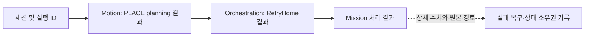

# 다중 컴포넌트 라이브 증거를 보존해 디버깅과 코딩 에이전트 분석을 지원한 과정

*Engineering Story — 2026-10-30 설계자 회고와 GitHub PR·설계·정책을 대조한 역사적 기록. 현재 Observability 계약, 검증 정책 또는 Acceptance 결과를 대체하지 않는다.*

## 문제와 설계 의도

ARM Cell의 실패는 Vision, Task Execution, Motion, Orchestration, Safety, Isaac 실행 환경처럼 여러 경계에 걸쳐 발생한다. 하나의 terminal code나 콘솔 로그만으로는 **무엇을 관측했고, 어느 컴포넌트가 어떤 판단을 했으며, 실제 런타임에서 어떤 일이 벌어졌는지**를 연결하기 어렵다.

설계자가 2026-10-30 직접 설명한 핵심 동기는 **라이브 관측과 당시 상태를 보존하여 문제를 재현하고 개선하는 것**이다. 이는 Vision 알고리즘뿐 아니라 다른 기능의 디버깅과 최적화에도 필수적이라고 판단했다. 시스템이 여러 컴포넌트·인터페이스를 오가는 만큼 경계별 증거가 연결되어야 한다.

코딩 에이전트가 개발에 참여하는 환경에서는 이 구조가 특히 중요하다고 평가했다. 기계가 판단 가능한 사실은 충분한 기록과 검증 근거를 제공하여 빠르게 분석하게 하고, **사람은 시스템 목적·사용자 의도·실제 실행 과정을 확인하고 최종 의미 판단을 내릴 수 있어야 한다.** 기록은 AI의 결론을 자동으로 정답으로 만드는 장치가 아니라, AI와 사람이 동일한 관측을 근거로 검토하고 오류를 교정하기 위한 기반이다.

## 구현과 운영의 발전

1. **운영 로그와 상세 증거의 역할 분리 — PR #399, PR #400.** 일반 log level과 별도로 `motion`, `vision`, `safety`, `orchestration` 기능 영역의 진단을 선택할 수 있도록 했다. 콘솔 INFO를 모든 내부 시도로 채우기보다 사람이 읽을 사건과 상세 파일 증거를 분리했다.
2. **세션과 개별 작업 식별의 분리 — PR #503, PR #505.** Isaac Timeline의 Play–Stop을 한 라이브 세션으로 묶고 ROS·Isaac 기록을 세션 문맥에서 탐색하게 했다. Session ID는 묶음 식별자이지 Acquisition, Motion Goal, Delivery 등 개별 실행의 authority를 대체하지 않는다. Pause/Resume과 Stop의 구분도 기록의 유효한 실행 구간을 설명하기 위해 필요했다.
3. **재분석할 수 있는 Vision 계산 근거 — PR #507.** 입력 Acquisition, 사용 Profile, Stage별 contour·edge·candidate·reject 단위 등을 보존하고 Snapshot과 Replay 분석에서 무엇이 실제 계산되었는지 추적하도록 했다. 단순히 최종 결과만 저장하는 방식보다 원인 분석에 적합하다.
4. **사후 분석과 독립 Ground Truth 비교 — PR #511, PR #512, PR #514, PR #516.** 라이브 종료 이후 보고서를 생성하고 Mission/Delivery 결과와 Vision·Motion·Isaac 기록을 연관한다. 검증되지 않은 프레임·객체 대응을 임의의 위치 오차로 환산하지 않고 비교 불가·미확인 상태를 보존한다. 보고서 생성 실패가 Isaac Stop과 Reset을 막지 않도록 세션 종료와 보고서 프로세스를 분리했다.
5. **테스트의 증명 범위와 유지보수성 재정의 — PR #628, PR #629, PR #632, PR #633.** 테스트는 계약·상태 전이·회귀를 보호하고, Synthetic/Mock/Replay와 Live는 서로 다른 주장을 증명한다. 구현 내부 필드·경로·형식에 과도하게 결합된 검사는 줄이되 의미 있는 결과·실패 경계 검증은 보존했다.
6. **Acquisition 중심의 증거 연결 — PR #744.** Vision Acquisition Snapshot·Metadata와 해당 Motion Occupancy Snapshot을 같은 Acquisition 폴더에서 참조할 수 있도록 정리해, 후보 선택 당시의 인지 근거와 실제 계획 점유 근거를 연결하기 쉬워졌다.

## 사람과 코딩 에이전트의 판단 경계

- **에이전트에게 적합한 분석:** 기계가 읽을 수 있는 timestamp·identity·result·단계별 시도·입출력·충돌/IK 근거를 연결하여 결함 위치를 좁히고, 변경 전후 테스트나 Replay를 비교하며 구체적 가설을 제시하는 작업.
- **사람이 판단해야 하는 의미:** 설계 목표와 허용 가능한 동작, 시뮬레이션 장면에서 실제로 일어난 일, 복구할 가치가 있는 실패, 최종 사용자 의도와 인수 기준. 이런 기준은 로그만으로 새로 생성되지 않는다.
- **양쪽 모두의 검증 책임:** 기록이 없는 사건은 추측으로 확정하지 않고, 측정값과 추론, 원래 Owner가 확정한 결과와 사후 분석의 해석을 분리한다. 에이전트의 정적 분석도 필요할 때는 라이브 실행으로 교차 검증한다.

이는 [Cross-cutting HLD](../../design/architecture/cross-cutting.md)의 공급→Mission→Acquisition→PnP→Movement 연결과 부합한다. 다만 이 Engineering Story가 새로운 공통 로깅 스키마, 전역 판단 Owner 또는 Gate를 제정하지 않는다.

## 기록 체계의 운영 비용과 검증 역할

선택적 기록, 세션 참조, 다층 Snapshot과 Replay는 기록량 및 관리 비용이 든다. 그러므로 모든 데이터를 콘솔에 출력하거나 모든 변수를 영구 보존하기보다는 분석 목적과 소유 컴포넌트에 맞는 증거를 남긴다. 구조화된 기록과 시각적 Snapshot은 서로 보완 관계다.

Engineering Testing Policy는 자동화 테스트가 의미 있는 계약과 회귀를 보호하되 모든 라이브 상황을 증명하지 않는다고 규정한다. 실제 PhysX 동작·센서 Timing·파지·배치·성능은 해당 환경의 Live Evidence를 요구한다. 분석 보고서의 존재는 Acceptance PASS가 아니며, 코딩 에이전트가 기록을 빠르게 읽을 수 있다는 사실도 진단의 정확도나 생산성 향상률을 입증하지 않는다.

## 확인된 활용 사례와 미측정 생산성 효과

개발자 회고에 따르면, 기록 체계는 알고리즘뿐 아니라 여러 컴포넌트의 디버깅·최적화에 필요했고, 사람이 런타임을 확인하면서 AI의 판단을 돕는 역할을 했다. 각 PR에서 관련 빌드·회귀·정적 검증이 보고되었지만, 이 기록에서 에이전트의 오류 발견 시간, 유지보수 시간 단축, 분석 정확도 등의 통제된 비교 실험을 수행하지는 않았다. 그런 수치를 성과로 주장하지 않는다.

## 정량 기록으로 추적한 진단 사례

### 기록에서 복구 원인까지 이어지는 증거

저장된 세션 기록은 원인 가설과 Mission 결과를 연결할 수 있지만, 그 자체로 수정 효과를 입증하지는 않는다. [실패 복구와 상태 소유권 기록](recoverable-failures-and-state-ownership-evolution.md#4-중복잔류-실행-상태가-복구를-방해한-사례)은 2026-10-28 세션에서 PLACE planning 실패 뒤 GO_HOME이 `TASK_RESULT_BUSY`로 거부된 구체적 진단과 원본 경로를 기록한다. 이 사례는 한 번의 Mission 실패를 특정하는 근거이며, 수정 전후 복구율이나 분석 시간 단축의 측정값은 없다.

## 참조와 향후 검증

- 이력: PR #399, PR #400, PR #503, PR #505, PR #507, PR #511, PR #512, PR #514, PR #516, PR #628, PR #629, PR #632, PR #633, PR #744.
- 현재 정책·설계: Engineering Testing Policy, [Cross-cutting HLD](../../design/architecture/cross-cutting.md).
- 대표 사례를 추가로 확보할 때는 원본 세션, 구체적인 에이전트 분석 가설, 인간의 판단/라이브 관찰, 수정 PR과 재검증 결과를 한 사례로 연결해야 한다.
